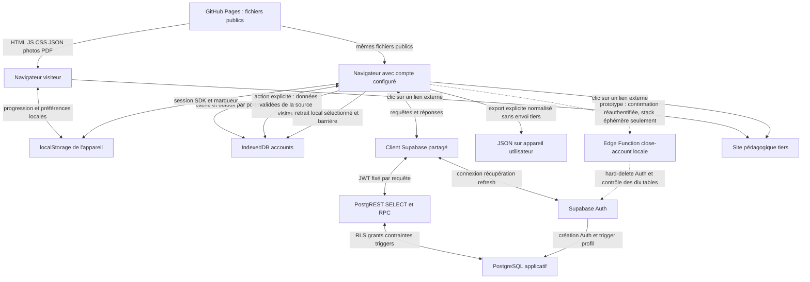

# Flux, prestataires et stockages terminaux

## Vérification ciblée D05/D06 — 6 novembre 2026

Le lot 6.5.5.G reprend les preuves publiques du 5 novembre pour GitHub Pages, Supabase Free et Outlook.com personnel. **P0-07 et P0-08 restent ouverts** jusqu’au rattachement des conditions et garanties à la cible et au circuit effectifs. Le service reste gratuit, temporaire et limité à sept adultes. Le contact Outlook.com et son fonctionnement sont acquis sur attestation de l’exploitant. [Reçu D04](RECU-ARBITRAGES-2026-11-05.md), [matrice P0](../deploiement/PLAN-PREOUVERTURE-PRIVEE.md#matrice-de-résolution-p0-01-à-p0-15).

Les lettres de cette vérification distinguent **A** constat de code ou d’artefact, **B** source officielle du fournisseur, **C** déclaration de l’exploitant, **D** inférence motivée du projet et **E** inconnue ou preuve à obtenir. Les références G, S et M renvoient au [registre des sources publiques](#registre-des-sources-publiques). Le relevé historique plus bas conserve ses propres repères.

**Actualisation ciblée du 8 novembre 2026.** Les métadonnées Supabase relues via le connecteur confirment Mon BPREA PROD `oqoqrxwfbkhtpksqimgd`, organisation `usdvhfuogofbhahjjobu`, offre Free et région `eu-central-1` (Francfort). Auth, API et base sont les services utilisés par l’artefact **[A]**. Le DPA public reste la version du 01/08/2026 et la FAQ de résidence celle du 06/10/2026 **[B]** ; ces documents et le rôle Owner ne démontrent pas l’acceptation contractuelle par le titulaire **[E, PF-01]**. La mission du 08/11 maintient la génération native et la remise personnelle, sans SMTP automatique, relais ou suivi ajouté par le projet **[C, PF-03]**. Aucun message ni lien n’a été remis et la boîte n’a pas été inspectée. Le texte candidat utilise ces faits sans affirmer un rattachement contractuel acquis ; approbation et publication restent séparées.

### Conditions et rôles par flux — P0-07

- **GitHub Pages.** GitHub héberge les ressources statiques choisies par l’exploitant et journalise l’IP de chaque visite pour sa sécurité, y compris hors connexion GitHub **[B, G1]**. Les conditions générales s’appliquent à Pages, dont les limites déconseillent les transactions sensibles **[B, G1–G2]**. Les fichiers publics et leur distribution sont distincts du stockage des profils et résultats par Supabase **[A]**. La finalité de sécurité documentée et la déclaration de GitHub justifient de retenir son rôle de responsable distinct pour ces traitements propres **[D, G1–G2]**. Le DPA GitHub publié concerne les services et données relevant d’un contrat client applicable **[B, G3]**. La qualification de sous-traitant sur instructions pour d’éventuels flux propres à Mon BPREA et l’application de ce DPA à ces visites restent sans preuve **[E]**. [Préparation de l’artefact](../../scripts/prepare-pages.py), [G1 à G3](#registre-des-sources-publiques).
- **Supabase Free.** Pour Auth, PostgREST et PostgreSQL (adresse, UUID, profil, progression, préférences), l’exploitant décide des finalités. Supabase est sous-traitant pour les données traitées sur instructions, y compris l’assistance liée à ces données, lorsque le DPA standard s’applique. Supabase décrit son rôle de responsable pour les informations de compte client et de facturation **[A/B/D, S1–S3]**. Les conditions Cloud incorporent le DPA standard sauf accord applicable distinct et ne l’excluent pas du seul fait de la gratuité. Elles désignent par défaut Supabase Pte. Ltd. (Singapour) en souscription directe et Supabase, Inc. en cas d’achat via AWS Marketplace, sauf stipulation contraire. Le titulaire, l’entité contractante et la version effectivement applicable restent à rattacher à l’organisation **[E, PF-01]**. Free prévoit un support communautaire, des limites de journaux propres à l’offre et des sauvegardes applicatives à organiser par le client **[B, S5–S6]**. L’assistance mondiale décrite dans la FAQ de résidence ne constitue pas un engagement de support prioritaire ou de délai pour Free. [S1 à S6](#registre-des-sources-publiques).
- **Outlook.com / Hotmail personnel.** Le contrat grand public inclut Outlook.com et désigne Microsoft Ireland Operations Limited pour le client relevant de sa clause territoriale EEE **[B, M1]**. La déclaration décrit le service de messagerie et ses finalités propres **[B, M2]**. L’exploitant choisit les destinataires, le contenu et le retrait de ses copies. Microsoft détermine les moyens et finalités propres de fonctionnement, de sécurité, de filtrage et de respect des obligations de sa messagerie. Retenir Microsoft comme responsable distinct pour ces finalités **[D]**. Le fournisseur de la boîte du destinataire constitue un flux distinct. Un DPA d’entreprise, une résidence réservée à un tenant ou des journaux d’audit Microsoft 365 professionnel ne sont pas établis pour ce compte **[E]**. [M1 et M2](#registre-des-sources-publiques).

La correspondance individuelle prévue pour ce service personnel, gratuit et sans prospection entre dans l’usage de messagerie décrit publiquement **[D, M1–M2]**. Le contrat couvre le transport, le stockage et les contrôles de sécurité du contenu. Les adresses, en-têtes, corps, éventuelles pièces jointes et liens peuvent donc être traités, dont la preuve temporaire si elle figure dans le message. Le Code de conduite encadre notamment le spam et le contrat prévoit des examens automatisés ou humains selon le cas. Ces textes ne démontrent ni une remise confidentielle de bout en bout ni une prestation sur instructions au sens de l’article 28. L’usage prévu se limite au contact et à la remise manuelle d’un lien temporaire à un destinataire vérifié, sans mot de passe, résultats ni envoi groupé **[A/C/D]**. Aucun obstacle contractuel propre à cet usage n’a été relevé dans les conditions publiques. La preuve restante porte sur le **circuit cible**, notamment l’absence de relais automatique ou de service tiers ajouté. Si un maillon supplémentaire intervient, qualifier son rôle et ses garanties avant de l’inclure dans la notice **[E, PF-03]**. [Procédure de remise](../deploiement/INVITATIONS-ET-RECUPERATION-MANUELLES.md), [S7, M1 à M3](#registre-des-sources-publiques).

### Liens temporaires et première requête

Le parcours préparé génère un lien natif remis individuellement. La requête initiale vers `authentification.html` comporte `token_hash` et `type` dans la chaîne de requête **[A]**. La preuve est utilisable pour la vérification, même sous forme de hash. Pages la reçoit avant l’exécution de JavaScript. Le nettoyage via `history.replaceState` et la politique de référent `no-referrer` réduisent la propagation ultérieure. La politique de référent ne protège pas la première requête et la présence de la preuve dans un journal Pages reste inconnue **[E]**. La vérification de la preuve et l’envoi du nouveau mot de passe vont directement à Supabase dans le parcours configuré **[A]**. [Génération du lien](../../scripts/auth-link-local.mjs), [page de retour](../../authentification.html), [service Auth](../../assets/auth-service.js), [limites Pages G1](#registre-des-sources-publiques).

Les messageries peuvent filtrer ou précharger des liens. Le parcours préparé attend une action explicite avant la vérification Supabase. Cela distingue le chargement de la page de la consommation de la preuve. Le comportement de chaque boîte ou filtre reste inconnu **[A/B/E, S7, M3]**. Avant remise réelle, apprécier la confidentialité de la preuve et l’adéquation du circuit aux limites Pages. Si l’exposition de la preuve dans la requête ne peut être maîtrisée, traiter dans un lot Auth distinct un transport qui la garde hors de la requête HTTP initiale, puis éprouver la remise et la confirmation avec données synthétiques. Cette réserve relève de la recette d’activation et de remise **P0-14/15**. La notice préparatoire informe de l’exposition actuelle **[D]**. [Page de retour](../../assets/auth-pages.js), [procédure](../deploiement/INVITATIONS-ET-RECUPERATION-MANUELLES.md).

### Matrice des lieux, transferts et conservations

| Fournisseur | Flux | Région ou lieux établis | Accès hors EEE | Garantie documentée | Conservation connue | Limite |
| --- | --- | --- | --- | --- | --- | --- |
| GitHub Pages | Distribution statique, IP et requêtes. La première requête du lien préparé transmet sa preuve **[A/B]** | GitHub cite la région locale, les États-Unis et d’autres pays pour son service **[B, G2]** | Possible pour les données du service **[B]** | Clauses contractuelles types (CCT) en général pour les destinations sans adéquation et DPF UE–États-Unis pour les transferts qu’il couvre **[B, G2]** | IP journalisée pour la sécurité **[B, G1]**. Critères selon finalité et obligations **[B, G2]** | Lieux et durée propres aux journaux Pages, traitement de la query et éventuelles copies techniques **[E]**. Aucun délai promis |
| Supabase Free | Auth, API, base et données de compte **[A]** | PostgreSQL, Auth et sauvegardes hébergées lorsqu’elles existent dans la région AWS choisie selon la FAQ **[B, S3]**. Cible PROD relue le 08/11 : `eu-central-1` (Francfort), Free **[A]** | Traitements hors région possibles. Une région européenne n’exclut pas un transfert **[B]** | DPA et CCT UE 2021/914, module 2 pour le flux responsable vers sous-traitant, mesures de sécurité de l’annexe 1 **[B, S2–S3]** | Si le DPA standard s’applique, restitution sur demande dans les 30 jours suivant la fin du contrat et suppression des copies couvertes à l’issue de ce délai sous les réserves du § 11.2 **[B, S2]** | Cette échéance suit la fin du contrat, tandis qu’une clôture individuelle relève du parcours Mon BPREA. Rattachement du contrat et des garanties aux services de la cible à confirmer **[E]** |
| Supabase Free | Support, accès techniques et chaîne de sous-traitance | Support mondial. Supabase Pte. Ltd. (Singapour) et filiale américaine pour le support et les opérations en souscription directe. AWS pour l’hébergement **[B, S3–S4]** | Accès possibles selon le besoin de support, d’exploitation ou d’incident. Les pays de la liste publique qualifient les entités listées **[B]** | CCT pour les transferts décrits vers Singapour et les États-Unis, chiffrement, contrôle et journalisation des accès. Obligations répercutées sur les sous-traitants autorisés **[B, S2–S4]** | Assistance et traces techniques selon leurs finalités, durée précise non publiée pour l’ensemble **[E]** | La liste globale inclut des services optionnels, de support et de gestion du compte client. Elle ne prouve pas leurs accès aux données des participants **[E]** |
| Supabase Free | Journaux, télémétrie et métadonnées techniques. Informations du compte exploitant | Selon la FAQ, ingestion et stockage des logs en UE, traitement technique hors région et gestion du compte client potentiellement centralisée hors région **[B, S3]** | Accès et traitement hors région possibles. Pays selon le flux et l’entité **[B/E]** | DPA pour les données couvertes traitées sur instructions. Politique Supabase pour les traitements propres du compte client **[B, S3]** | Free annonce **un jour pour les logs API et base** dans la grille **[B, S5]** | Fenêtre de l’offre, sans preuve du délai d’effacement de toutes les copies, journaux Auth, internes ou de support **[E]** |
| Supabase Free | Copies de sécurité de la base et sauvegarde du projet | Sauvegardes gérées, lorsqu’elles existent, annoncées dans la région de la base **[B, S3]**. Copies faites par l’exploitant régies séparément | Lieux des accès techniques propres aux copies non établis **[E]** | Chiffrement de la base et des sauvegardes gérées annoncé. DPA pour les données couvertes lorsqu’il s’applique **[B, S2–S3]** | Pas de sauvegarde quotidienne automatique Free ni de PITR inclus. Pro propose sept jours de sauvegardes quotidiennes. La sauvegarde applicative de Mon BPREA suit sa politique propre **[B, S5–S6]** | Cette offre ne prouve ni l’absence de toute copie technique ni l’existence d’une copie applicative actuelle. Les preuves de rotation et de reprise relèvent de P0-12 |
| Outlook.com personnel | Contact, assistance, droits, adresses, en-têtes, contenu et remise des liens. Copies chez le destinataire | Selon la déclaration, stockage principal généralement dans la région de l’utilisateur ou aux États-Unis, sauvegardes possibles dans une autre région **[B, M2]** | Traitements possibles aux États-Unis et ailleurs par Microsoft, ses affiliés et fournisseurs **[B, M2]** | CCT selon le flux et DPF pour les transferts américains couverts de Microsoft Corporation **[B, M2]** | Critères de durée selon le service, les finalités et obligations. Les messages retirés peuvent rester récupérables **[B, M2/M3]** | Site exact de la boîte, pays de chaque copie, durée de chaque journal et règles du fournisseur du destinataire **[E]**. La déclaration indique environ sept jours dans Éléments supprimés puis au plus 30 jours après vidage, avec réserve légale. L’aide indique 30 jours dans le dossier puis 30 jours de récupération **[B, M2/M3]** |

La liste Supabase du 12/10/2026 distingue notamment AWS (hébergement), Supabase, Inc. (support) et Cloudflare (hébergement/CDN). La FAQ associe le CDN de contenu au service Storage quand il est utilisé. La liste couvre aussi la communication avec les utilisateurs autorisés et le suivi d’erreurs. Elle ne démontre aucun relais SMTP ni usage Storage pour les participants **[B/E, S3–S4]**. Le relevé historique de DEV indiquait `eu-west-1` (Irlande) ; la cible PROD relue le 08/11 est `eu-central-1` (Francfort), sans preuve de résidence intégrale des traitements **[A]**. [Matrice DEV historique](../deploiement/MATRICE-ECARTS-DEV.md), [politique de conservation](POLITIQUE-CONSERVATION-PROJET.md).

### Preuves matérielles restantes

| ID | Fournisseur | Information à confirmer | Pourquoi | Méthode future | Sensibilité | Bloquant ? |
| --- | --- | --- | --- | --- | --- | --- |
| PF-01 | Supabase | Nom de l’organisation et titulaire juridique de la cible choisie, entité Supabase contractante, conditions acceptées (version/date ou pièce de rattachement), DPA standard applicable ou accord distinct | Identifier le sous-traitant et établir les obligations et CCT réellement opposables | Rapprocher la fiche organisation/projet et les pièces du titulaire (acceptation, conditions du compte ou commande). Une référence datée et le lien du DPA suffisent si le rattachement est démontré | Identité et pièces contractuelles privées | Oui, P0-07 et rattachement des garanties P0-08 |
| PF-02 | Supabase | Offre et région AWS exactes, services pertinents (Auth, API/base, éventuels services annexes), sous-traitants et garanties de transfert utiles pour ces services et l’assistance | Finaliser destinataires, localisation principale et garanties dans la notice, sans étendre les délais du plan à toutes les copies | Relever les métadonnées non secrètes de l’offre, de la région et des services, puis rapprocher S2–S6 du contrat PF-01. Ne rechercher une pièce complémentaire que si un flux nécessaire reste sans garantie rattachable | Configuration et synthèse des garanties privées | Oui, P0-08. Les emplacements physiques et durées exhaustives restent des limites |
| PF-03 | Supabase / Outlook.com personnel | Confirmer que la chaîne retenue utilise la génération native et la remise individuelle déjà choisie, sans SMTP automatique, relais ou dispositif de suivi ajouté par le projet | Décrire qui reçoit l’adresse et la preuve. Un changement de transport modifierait les rôles, lieux et garanties | Consigner le circuit cible en une fiche privée, à partir du choix opérateur et des seules métadonnées non secrètes des services d’envoi utiles. Le relevé peut être déclaratif pour les opérations manuelles. Aucune connexion à la boîte ni aucun envoi de vérification | Circuit et réglages privés, aucune adresse ni preuve d’accès | Oui, pour figer les destinataires P0-07/08. Le contrôle du contact D04 est acquis |

Ce relevé ne demande ni audit de boîte ni nouvel arbitrage de canal. Les lieux précis des copies Outlook.com et les délais exhaustifs des journaux et caches fournisseurs sont des limites à expliquer, sans condition de clôture supplémentaire. Les durées de Mon BPREA couvrent les copies qu’il gère. Pour la version finale, documenter la garantie applicable aux flux hors EEE du projet, avec le moyen d’en obtenir copie, et décrire séparément les traitements propres annoncés par GitHub et Microsoft. Toute invocation d’une adéquation DPF pour un flux précis doit correspondre à une entité et un périmètre couverts. [Article 13 du RGPD](https://www.cnil.fr/fr/reglement-europeen-protection-donnees/chapitre3), [mandat futur](../deploiement/ARBITRAGES-FINAUX-PREOUVERTURE.md#projet-de-mandat-de-lecture-fournisseur).

### Registre des sources publiques

Sources **B** relues le **06/11/2026**. La date de consultation s’applique à chaque référence. Les dates de document ci-dessous sont celles affichées par les éditeurs quand elles sont disponibles.

| Réf. | Document et version | Périmètre et affirmation soutenue | Limite |
| --- | --- | --- | --- |
| G1 | [What is GitHub Pages? — Data collection](https://docs.github.com/en/pages/getting-started-with-github-pages/what-is-github-pages#data-collection), [GitHub Pages limits](https://docs.github.com/en/pages/getting-started-with-github-pages/github-pages-limits) | Hébergement statique, IP journalisée pour sécurité et conditions d’usage, dont la réserve sur les transactions sensibles | Aucun champ de log de query ni délai propre à Pages publié ici |
| G2 | [GitHub Terms of Service](https://docs.github.com/en/site-policy/github-terms/github-terms-of-service) et [GitHub General Privacy Statement](https://docs.github.com/en/site-policy/privacy-policies/github-general-privacy-statement), effectifs le 27/04/2026 | Conditions générales, catégories de données de service, rôle propre, lieux possibles, CCT/DPF et critères de rétention | Les catégories générales ne décrivent pas le contenu exact des logs Pages |
| G3 | [GitHub Data Protection Agreement](https://github.com/customer-terms/github-data-protection-agreement), § 1–3 | Porte sur les services fournis sous contrat client conclu et les données couvertes, avec rôles selon les finalités | Le texte standard ne prouve pas son rattachement au projet |
| S1 | [Supabase Terms of Service](https://supabase.com/terms), § 1 et 2, texte public courant (date non affichée dans la version lue) | Services Cloud, acceptation et incorporation du DPA sous réserve d’un accord distinct, entité par canal de souscription | Version et conditions de l’organisation à vérifier |
| S2 | [Supabase Data Processing Addendum](https://supabase.com/legal/customer-resources/data-processing-addendum), v1 du 01/08/2026, § 3–6, 11–12 et annexes 1–3 | Instructions, chaîne de sous-traitance, sécurité, restitution/effacement des données couvertes en fin de contrat et CCT | Accord applicable et services pertinents à rattacher, délai distinct de la suppression d’un compte |
| S3 | [Data Residency and Transfers FAQ](https://supabase.com/legal/privacy-resources/data-residency-and-transfers-faq), v1 du 06/10/2026, [Regions](https://supabase.com/docs/guides/platform/regions), 19/10/2026 | Résidence primaire, accès et support hors région, ingestion/stockage des logs dans l’UE selon la FAQ, CCT et mesures supplémentaires. Le groupe « Europe » de la documentation peut inclure Londres et Zurich | Aucune région d’un projet ni résidence intégrale déductible de ces guides |
| S4 | [Index Supabase Subprocessor List](https://supabase.com/legal/customer-resources/subprocessor-list) et [liste du 12/10/2026](https://supabase.com/legal/subprocessor-list/October-12-2026.pdf) | Entités, pays et fonctions au niveau fournisseur | Pays de l’entité distinct de la région de stockage et liste distincte des services utilisés |
| S5 | [Supabase Pricing](https://supabase.com/pricing), grille courante, [Logs](https://supabase.com/docs/guides/observability/logs), 22/09/2026 | Support communautaire Free et durée des logs API/base selon l’offre. Un jour en Free et sept en Pro | Grille d’offre et non engagement individuel sur la suppression de toute trace |
| S6 | [Database Backups](https://supabase.com/docs/guides/platform/backups), 05/11/2026, [Free plan backups](https://supabase.com/kb/faqs/platform/free-plan-backups), 30/10/2026 | Sauvegardes quotidiennes pour offres payantes, sauvegarde à organiser pour Free, PITR en option payante | Aucune copie existante ni garantie de reprise du projet établie |
| S7 | [Send emails with custom SMTP](https://supabase.com/docs/guides/auth/auth-smtp), 31/10/2026, [Email Templates](https://supabase.com/docs/guides/auth/auth-email-templates), 29/10/2026 | SMTP par défaut limité aux adresses de l’équipe. Préchargement et réécriture possibles avec certaines messageries ou services de suivi | Aucun relais, abonnement ou comportement de boîte constaté pour la cible |
| M1 | [Contrat de Services Microsoft](https://www.microsoft.com/fr-fr/servicesagreement), publié le 30/07/2026, effectif le 30/09/2026 | Outlook.com grand public, entité contractante en EEE selon la clause territoriale, contenu et sécurité (dont anti-spam) | Conditions grand public, pas de preuve d’un contrat d’entreprise pour cette boîte |
| M2 | [Déclaration de confidentialité Microsoft](https://www.microsoft.com/fr-fr/privacy/privacystatement), septembre 2026, sections Outlook, conservation et stockage/traitement | Traitements propres, contenu de messagerie, lieux possibles, CCT/DPF et conservation | Aucune localisation de cette boîte ni durée totale de conservation de ses copies |
| M3 | [Récupérer des éléments dans Outlook](https://support.microsoft.com/fr-fr/outlook/mail/recover-and-restore-deleted-items-in-outlook), [Sécurité Outlook.com avancée pour les abonnés Microsoft 365](https://support.microsoft.com/fr-fr/outlook/advanced-outlook-com-security-for-microsoft-365-subscribers) | Fenêtres de récupération affichées dans l’aide et contrôle renforcé de liens pour certains abonnements personnels | Pas de preuve de l’offre ou de réglages réels. Divergence de durée avec M2 |

Le changelog Supabase a été relu en HTML après refus du format Markdown par le lecteur web. Les restrictions du SMTP intégré Free restent distinctes du circuit manuel préparé. [Changelog](https://supabase.com/changelog).

## Cartographie technique historique et précisions d’usage

Les relevés du 27 et du 28 octobre 2026 ci-dessous conservent les capacités du dépôt au moment de l’inventaire. Pour les contrats et l’état des décisions, appliquer la vérification G ci-dessus. Le flux F08 décrit la chaîne préparée à l’époque. Pour la future exploitation privée, la remise manuelle sans SMTP automatique est le choix en vigueur. Pour les accès au terminal, appliquer l’[analyse D12 approuvée](ANALYSE-STOCKAGES-NAVIGATEUR-D12.md).

## Cartographie des chemins implémentés (A)

Le sous-graphe personnel décrit **un environnement configuré**. Le défaut public `enabled:false` s'arrête avant la création du client Supabase. Le diagramme ne prétend pas que des étudiants utilisent déjà ces flux. Les flèches locales ne sont pas des transferts réseau.

La flèche d'import ne concerne que cours/QCM, botanique, ITK et apparence ; elle suit un aperçu et une confirmation, conserve les sources, et ne résulte jamais de la simple connexion. Le Drill ne propose pas cet import. Un second appareil personnel suit le même chemin SDK/API/DB ; **aucun transfert direct entre appareils ni synchronisation du localStorage visiteur par Mon BPREA**. Une synchronisation propre au navigateur/OS n'est pas vérifiable depuis le dépôt.

## Fiches des flux

| Flux / statut | Source → destination, données et finalité | Quand / authentification / transport | Contrôle d'accès, persistance et risque |
| --- | --- | --- | --- |
| F01 — A | Navigateur → GitHub Pages → navigateur : fichiers statiques publics et requêtes HTTP | Visite/rechargement/chargement JSON et PDF ; pas de compte exigé. La chaîne de déploiement est [deploy.yml](../../.github/workflows/deploy.yml) → [prepare-pages.py](../../scripts/prepare-pages.py). HTTPS du site publié non retesté dans ce lot ; essais locaux HTTP boucle locale | Aucune donnée privée dans les fichiers publiés. Cache HTTP possible. **B** : IP journalisée par Pages pour la sécurité [B7]. Query initiale peut contenir A06/X03 ; logs fournisseur non accessibles. |
| F02 — A | Visiteur ↔ localStorage : D01/Q01/B01/I01/P01/P02/X01 ; progression et confort | Actions pédagogiques/choix, lectures au démarrage ; pas d'authentification ; flux interne sans TLS à qualifier | Même origine/profil, sans chiffrement applicatif ; données conservées, risque d'appareil partagé et de mauvaise attribution. Preuves : stores et services de l'inventaire. |
| F03 — A | Navigateur personnel ↔ IndexedDB : D02–D03/Q02–Q03/B02–B03/P05 | Avant envoi puis après confirmation/récupération ; session vérifiée ou continuité locale fiable limitée, transactions atomiques | Portée environnement/origine projet/UUID ; générations et annulation des retours tardifs. Reste lisible par le profil navigateur, conservé après déconnexion ; perte possible par quota/éviction. |
| F04 — A | Formulaire/SDK ↔ Supabase Auth : e-mail, mot de passe, preuve de lien, session et métadonnées retournées | Connexion, récupération, activation volontaire, refresh, déconnexion locale. `validateAuthConfiguration` exige HTTPS hors boucle locale DEV ; pas de mesure de TLS réel ni d'audit du réseau interne fournisseur | SDK gère A02/A03 ; service valide `getUser`. Marqueur A04 ne suffit pas pour une API distante. Mot de passe et tokens restent hors caches pédagogiques ; XSS/extensions et sessions persistantes restent des risques. |
| F05 — A | Navigateur/transport ↔ PostgREST SELECT : profil, séries et historiques personnels, paramètres | Démarrage, actualisation, retour réseau/Auth et relectures selon service, dont export explicite. Clé publique et JWT personnel ; HTTPS exigé en hébergé | Filtres `user_id`/`id` + RLS ; pages et passes complètes, pas de snapshot global. Réponses validées/cache P ; lecture partielle distincte d'un historique complet. [Transports](../../assets/settings-transport.js), [Drill](../../assets/drill-sync-transport.js), [cours](../../assets/course-quiz-transport.js), [botanique](../../assets/botanical-sync-transport.js), [export](../../assets/export-transport.js). |
| F06 — A | Outbox personnelle → SDK → PostgREST/RPC → PostgreSQL : intentions validées, UUID d'opération, base de révision, dates | Après persistance locale, retry exact et retour de session vérifiée ; pas d'envoi en mode seulement hors ligne | RPC Drill et six RPC personnelles `SECURITY INVOKER`, grants/RLS/guards aussi sur écritures directes ; CAS pour mutables, append-only pour historiques. Erreurs/pertes d'acquittement laissent copies et conflits. La clôture locale distincte relève de F16, pas de ces RPC. |
| F07 — A | Service de confiance → Auth → trigger profil | Invitation administrative native, **capacité préparée**, aucun appel d'invitation depuis le frontend ni dans cet audit | Création du profil atomique avec Auth ; trigger definer privé à droits retirés. Identité/habilitations du futur opérateur : D01/D02 des [décisions](DECISIONS-A-VALIDER.md). Pas de rôle formateur ou accès interétudiants implémenté par les migrations. |
| F08 — A/B/D | Auth → service d'e-mail → boîte du destinataire → lien Pages → `verifyOtp` Auth : adresse, message, preuve temporaire | Modèles [invite](../../supabase/templates/invite.html)/[recovery](../../supabase/templates/recovery.html) et reset implémentés ; expédition réelle, fournisseur SMTP, accès et chiffrement des maillons **non vérifiés** [B11] | Première query sensible reçue par l'hébergeur avant nettoyage. Confirmation explicite, `no-referrer`, pas de suivi de clic dans le code des modèles ; réglages réels du fournisseur inconnus. En CI, SMTP capturé uniquement dans la stack locale. |
| F09 — A | Source visiteur → mémoire d'aperçu → manifeste brut en P → RPC des seuls champs validés | Confirmation explicite, source/provenance inchangées et récupération distante fraîche ; même identité jusqu'au commit | Pas d'import implicite ; refus conservateurs des copies ambiguës, archives locales sans rétention temporelle. Risque : données visiteur appartenant à autrui et duplication dans `raw`. [Import cours](../../assets/course-quiz-import.js), [botanique](../../assets/botanical-import.js), [paramètres](../../assets/settings-service.js). |
| F10 — A | Onglet ↔ autres onglets de même origine : portée pédagogique X02, ou session Auth A07 | Après commit local / événement SDK ; BroadcastChannel, pas de TLS ni serveur car communication locale | Pas de stockage autonome. Le canal SDK peut porter une session complète, à ne jamais journaliser ; tous les scripts de même origine doivent être dignes de confiance. |
| F11 — A/D | Navigateur → site externe choisi : requête web, IP et métadonnées réseau du visiteur | Uniquement clic sur ressources/crédits/anecdote ; liens `noopener noreferrer` dans les composants concernés ; URL généralement HTTPS, pas d'audit du site cible | Aucun résultat personnel envoyé explicitement dans ces liens. Le site tiers applique ses propres traceurs/règles ; inconnus sans audit distinct. Les photos du jeu utilisent des chemins locaux, les PDF contrôlés automatiquement sont locaux. |
| F12 — A | Générateur ITK → DOM/Blob/impression → fichier utilisateur éventuel | Génération et clic CSV/impression, sans envoi de document complet à Supabase | Pas de stockage applicatif de calendriers/PDF/CSV complets. Une copie téléchargée, imprimée ou sauvegardée par l'OS échappe à une future suppression distante. |
| F13 — B/D | Infrastructure Pages/Auth/API/DB/SMTP → logs, sauvegardes et personnels habilités du prestataire | Capacités/prestations décrites officiellement [B7–B12] ; contenu et déclencheurs précis non observés dans le projet | Ce n'est pas un flux réseau démontré par le frontend pour chaque catégorie. Identifier contrats, sous-traitants, lieux, accès support et rétention ; RLS ne protège pas contre un administrateur privilégié. |

## Flux de droits ajoutés après l'inventaire initial

F05 est désormais aussi utilisé par l'export préparé ; F06 ne décrit que les écritures pédagogiques. Il n'y a pas d'endpoint d'export dédié : les SELECT existants sont utilisés. La clôture relève de F16.

| Flux / statut | Source → destination et données | Quand / autorisation | Persistance / limite |
| --- | --- | --- | --- |
| F14 — A, copie 6.4.2 | Auth/SELECT dix tables + quatre caches de la portée → mémoire → Blob/JSON remis au navigateur ; sélection visiteur indépendante | Action explicite, vérification Auth fraîche et JWT fixé ; deux passes concordantes, pas de snapshot global | Ni envoi tiers ni nouvelle écriture pédagogique. Secrets, bruts et champs non attribuables exclus ; téléchargement remis non rappelable. [Contrat](../architecture/EXPORT-DONNEES-PERSONNELLES.md). |
| F15 — A, retrait local 6.4.3 | Choix confirmé → transaction `accounts + privacy`, ou retrait des clés visiteur choisies | Identité personnelle fraîche, générations et Web Locks ; aucune requête de suppression serveur | Invalidation inter-onglets, barrières v2 par portée ; localStorage multiclés et quatre bases non globalement atomiques. États partiels explicites, B préservé. |
| F16 — A, clôture locale 6.4.3 | Navigateur → `close-account` → réauthentification Auth → hard-delete administratif → contrôle Auth/dix tables | Seulement API interne locale autorisée, JWT gateway + `getUser`, mot de passe courant puis capacité liée au JWT exact | Aucun UUID cible libre, secret admin côté serveur uniquement. Aucun déploiement. Pas de dossier de demande persistant ni log applicatif du contenu ; logs d'infrastructure non audités. [Protocole](../architecture/SUPPRESSION-DONNEES-PERSONNELLES.md). |

Il n'existe pas de connexion directe PostgreSQL depuis le navigateur. L'e-mail n'est pas répliqué dans les tables pédagogiques. Realtime, Storage et analytics ne sont pas utilisés. Une Edge Function de clôture **locale seulement** existe désormais ; elle refuse les origines Supabase hébergées. Sa présence ne prouve aucune activité DEV/PROD.

**Recette 6.4.4 :** les 17 documents de l'artefact local versionné sont examinés dans des contextes vierges, avec Auth désactivée ; aucun domaine externe sollicité, cookie/Set-Cookie, stockage personnel, Cache API ou service worker observé. Les liens tiers sont inventoriés sans navigation. Les parcours synthétiques de compte restent une preuve distincte de caches et session, pas celle de l'artefact public. La query de callback atteint bien la première requête HTTP avant nettoyage ; `q` peut rester dans l'URL. Périmètre et résultats : [validation](../archives/validations/VALIDATION-LOT6-4-4.md). Aucune réponse réelle Pages/Supabase/SMTP hébergée n'est auditée ; aucune exemption juridique générale déduite.

## Prestataires et intervenants

| Intervenant | Rôle technique et données constatées/possibles | Localisation/transferts et qualification | À obtenir avant ouverture (D) |
| --- | --- | --- | --- |
| GitHub Pages / infrastructure GitHub | A : distribue les fichiers publics ; aucune progression n'est envoyée à GitHub par une API pédagogique. B : journalise l'IP des visites [B7] ; sa politique décrit ses propres traitements [B8] | Aucun engagement « UE exclusivement » vérifié. Qualification à analyser **par traitement** : hébergement du site, sécurité propre au prestataire et compte d'exploitation ne se confondent pas | Entité contractante/conditions applicables, rôle juridique selon activité, destinataires infrastructure, localisation/accès support, garanties de transfert, rétention des logs et traitement des queries sensibles. |
| Supabase Auth / API / PostgreSQL hébergé | A : client et schéma préparés pour comptes/profils/progression/préférences. B : régions, sessions, sauvegardes et DPA disponibles [B9–B12] | La base PostgreSQL applicative et le service Auth sont distincts logiquement dans l'inventaire, sans prétendre deux prestataires séparés. Région **du projet inconnue**. DPA public version du 01/08/2026 : rôles et garanties conditionnels au contrat ; une région principale ne couvre pas tous les accès/transferts | Souscription/plan, région effective de chaque projet, entité/contrat et rôle par activité, sous-traitants réellement mobilisés, lieux d'accès, mécanismes de transfert et garanties applicables, habilitations admin, backups/logs/PITR et effacement. |
| Sous-traitants de Supabase / hébergeur matériel PostgreSQL | B : index officiel de sous-traitants, liste annoncée au 12/10/2026 [B13]. Aucune déduction depuis le suffixe d'URL du projet | Liste détaillée non récupérée par le lecteur web pendant cet audit ; **ne pas attribuer arbitrairement AWS, une région ou un flux à une société** | Archiver en espace interne la liste applicable/contrat, identifier la chaîne d'hébergement et les catégories reçues, pays, accès et notifications de changement. |
| E-mails transactionnels et messagerie du destinataire | A : contenu des modèles/URL ; B : guide SMTP [B11]. Fournisseur SMTP réel non identifié | SMTP par défaut, personnalisé ou relais : choix/configuration non vérifiés ; réception par une messagerie externe implique une chaîne supplémentaire | Fournisseur/contrat, région/transferts, chiffrement et rétention, logs, antispam/réécriture, absence de suivi/pixel, SPF/DKIM/DMARC et responsabilité de l'invitant. Aucune invitation envoyée dans ce lot. |
| Sites de ressources/crédits | A : catalogue [resources.json](../../assets/resources.json), anecdotes [daily-facts.json](../../assets/daily-facts.json), crédits [botanical-bank.json](../../assets/botanical-bank.json) : Chlorofil, GRAB, CTIFL, EcophytoPIC, Météo-France/data.gouv, INRAE/ephytia, FAO, NC State, Kew, Wikimedia/Commons, Creative Commons et crédit Lucnix | Liens sortants, pas sous-traitants présumés ni intégrations recevant les résultats. Pas de chargement distant des photos à l'affichage du jeu. Localisation et traceurs de ces sites non audités | Réexaminer toute évolution vers contenu embarqué, iframe, CDN ou tracking avant activation. Information claire sur la sortie vers un site tiers. |
| Navigateurs, OS, extensions et appareil partagé | A : stockage et affichage local. Aucune synchronisation navigateur/OS implémentée par Mon BPREA | Pas de prestataire choisi par l'application pour ces copies ; réglages de l'utilisateur inconnus | Définir conseil d'usage, gestion des copies hors ligne et portée réaliste des droits sur les appareils absents. |
| npm/outils/CI | A : outils de développement Node 24, SDK compilé localement, fixtures synthétiques ; Chromium/CLI dans la stack de test | Pas de CDN de production ni transfert étudiant déduit de l'installation npm ; logs/traces CI pourraient devenir sensibles avec de mauvaises fixtures | Préserver données fictives, secrets masqués et artefacts non publiés ; documenter tout nouveau service d'observabilité avant usage. |

## Cookies et autres accès au terminal

**B :** la règle CNIL ne se limite pas aux cookies HTTP. L'exemption concerne une nécessité pour la communication ou un service expressément demandé ; les traitements personnels associés restent à examiner au titre du RGPD. [Règles CNIL, B2](https://www.cnil.fr/fr/cookies-et-autres-traceurs/regles/cookies/comment-mettre-mon-site-web-en-conformite), consultation 27/10/2026.

| Usage audité A | Qualification provisoire C / décision D | Conséquence proposée |
| --- | --- | --- |
| Session Auth persistée, marqueur de continuité, file/cache de synchronisation | Candidat à l'exemption fonctionnelle pour le service personnel demandé ; vérifier nécessité de chaque copie et durée, particulièrement mode hors ligne | Pas d'acceptation globale « RGPD ». Information sur persistance et ordinateur partagé ; justifier la conservation locale séparément de l'accès distant. |
| Sauvegarde visiteur des exercices/cours/botanique/ITK et provenances | Fonction de sauvegarde/reprise, pas marketing détecté ; absence de marketing ne suffit pas à démontrer l'exemption de chaque accès | D : préciser demande utilisateur, nécessité, durée et alternatives pour traces annexes/imports ; minimiser les sources brutes conservées dans les lots suivants. |
| Apparence et anecdote masquée | Personnalisation fonctionnelle, candidate à l'exemption selon le service attendu ; aucune audience ni publicité identifiée | Documenter choix, clés et durée réelle, sans présenter toutes préférences comme exemptées d'office. |
| Sites tiers sur clic | Traceurs du site cible inconnus ; aucune iframe/mesure d'audience intégrée détectée | Auditer avant ajout d'embarquement. Si une finalité non exemptée apparaît : consentement préalable adapté à cette finalité, à concevoir à ce moment. |
| Cookies infrastructure et cache HTTP | Dépôt seul insuffisant ; recette locale ne reproduit pas les réponses Pages/CDN/SMTP | Vérification ciblée de l'artefact et des réponses hébergées à prévoir dans la recette autorisée 6.4.4, sans donnée réelle. |

**C : aucun bandeau ajouté dans 6.4.1**, faute de finalité non exemptée détectée justifiant son implémentation. Ceci n'est ni une conclusion juridique d'exemption générale, ni une affirmation d'absence universelle de cookies/traceurs. Résultats navigateur limités dans le [rapport](../archives/validations/VALIDATION-LOT6-4-1.md).

## Sources officielles (B), consultées le 27 octobre 2026

| Réf. | Source et portée vérifiée |
| --- | --- |
| B1 | [CNIL — registre des activités](https://www.cnil.fr/fr/RGPD-le-registre-des-activites-de-traitement) : finalités, contenu et nature interne du registre. |
| B2 | [CNIL — cookies et autres traceurs](https://www.cnil.fr/fr/cookies-et-autres-traceurs/regles/cookies/comment-mettre-mon-site-web-en-conformite) : nécessité, exemption et consentement selon finalité. |
| B3 | [CNIL — AIPD](https://www.cnil.fr/fr/ce-quil-faut-savoir-sur-lanalyse-dimpact-relative-la-protection-des-donnees-aipd) : listes et critères ; page canonique en timeout, contenu officiel accessible avec [variante de query](https://www.cnil.fr/fr/ce-quil-faut-savoir-sur-lanalyse-dimpact-relative-la-protection-des-donnees-aipd?trk=article-ssr-frontend-pulse_little-text-block). |
| B4 | [CNIL — information/transparence](https://www.cnil.fr/fr/conformite-rgpd-information-des-personnes-et-transparence) : clarté, moment et mentions d'information. |
| B5 | [RGPD — EUR-Lex](https://eur-lex.europa.eu/legal-content/FR/TXT/?uri=CELEX:32016R0679) : référence officielle demandée, lecture bloquée par vérification antirobot ; texte consulté sur CNIL, [chapitre II](https://www.cnil.fr/fr/reglement-europeen-protection-donnees/chapitre2), [chapitre III](https://www.cnil.fr/fr/reglement-europeen-protection-donnees/chapitre3), [chapitre IV](https://www.cnil.fr/fr/reglement-europeen-protection-donnees/chapitre4). |
| B6 | [Supabase — changelog](https://supabase.com/changelog) : consulté après échec de lecture du format `.md`. Avis TLS HTTP API du 12/10/2026 repéré ; aucune mise à jour SDK ou configuration introduite par ce lot documentaire. |
| B7 | [GitHub — fonctionnement Pages, Data collection](https://docs.github.com/en/pages/getting-started-with-github-pages/what-is-github-pages#data-collection) : collecte des IP de visites pour sécurité, même sans connexion GitHub. |
| B8 | [GitHub — politique générale de confidentialité](https://docs.github.com/en/site-policy/privacy-policies/github-general-privacy-statement) : traitements et transferts décrits par GitHub ; pas preuve du contrat de l'exploitant. |
| B9 | [Supabase — régions disponibles](https://supabase.com/docs/guides/platform/regions) : choix de régions, aucune identification du projet audité. |
| B10 | [Supabase — sessions](https://supabase.com/docs/guides/auth/sessions) : JWT/refresh et durée configurable ; ne pas assimiler expiration JWT et effacement des copies. |
| B11 | [Supabase — SMTP](https://supabase.com/docs/guides/auth/auth-smtp) : nécessité de vérifier la livraison et le fournisseur réel ; pas preuve de configuration hébergée. |
| B12 | [Supabase — sauvegardes](https://supabase.com/docs/guides/platform/backups) et [DPA](https://supabase.com/legal/customer-resources/data-processing-addendum) : capacités liées au plan et cadre contractuel public ; contrat/plan réel non vérifié. |
| B13 | [Supabase — index des sous-traitants](https://supabase.com/legal/customer-resources/subprocessor-list) : index daté ; contenu détaillé du document lié non récupéré, chaîne effective à confirmer. |

Ces sources ne remplacent pas les preuves contractuelles privées ni les décisions du responsable à identifier. Conserver ces dernières hors du dépôt public ; ne publier ici qu'un statut et les mentions autorisées nécessaires à l'information.
