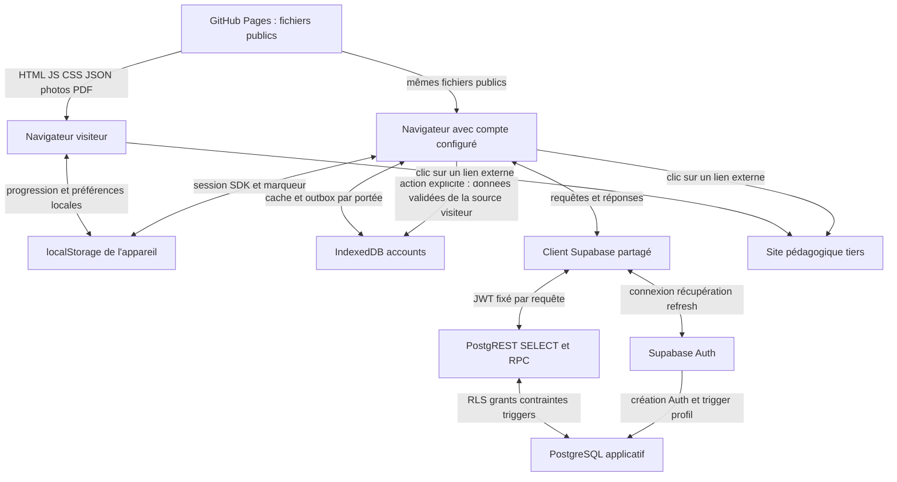

# Flux, prestataires et stockages terminaux — lot 6.4.1

Audit du 27 octobre 2026. Catégories **A** (code/exécution), **B** (source officielle), **C** (recommandation), **D** (décision non validée) définies dans l'[inventaire](INVENTAIRE-DONNEES.md). Les identifiants A01 à X09 désignent cet inventaire. Aucune configuration hébergée n'a été interrogée. La région, les contrats, les comptes administratifs et les logs réels restent inconnus.

## Cartographie des chemins implémentés (A)

Le sous-graphe personnel décrit **un environnement configuré**. Le défaut public `enabled:false` s'arrête avant la création du client Supabase. Le diagramme ne prétend pas que des étudiants utilisent déjà ces flux. Les flèches locales ne sont pas des transferts réseau.

La flèche d'import ne concerne que cours/QCM, botanique, ITK et apparence ; elle suit un aperçu et une confirmation, conserve les sources, et ne résulte jamais de la simple connexion. Le Drill ne propose pas cet import. Un second appareil personnel suit le même chemin SDK/API/DB ; **aucun transfert direct entre appareils ni synchronisation du localStorage visiteur par Mon BPREA**. Une synchronisation propre au navigateur/OS n'est pas vérifiable depuis le dépôt.

## Fiches des flux

| Flux / statut | Source → destination, données et finalité | Quand / authentification / transport | Contrôle d'accès, persistance et risque |
| --- | --- | --- | --- |
| F01 — A | Navigateur → GitHub Pages → navigateur : fichiers statiques publics et requêtes HTTP | Visite/rechargement/chargement JSON et PDF ; pas de compte exigé. La chaîne de déploiement est [deploy.yml](../../.github/workflows/deploy.yml) → [prepare-pages.py](../../scripts/prepare-pages.py). HTTPS du site publié non retesté dans ce lot ; essais locaux HTTP boucle locale | Aucune donnée privée dans les fichiers publiés. Cache HTTP possible. **B** : IP journalisée par Pages pour la sécurité [B7]. Query initiale peut contenir A06/X03 ; logs fournisseur non accessibles. |
| F02 — A | Visiteur ↔ localStorage : D01/Q01/B01/I01/P01/P02/X01 ; progression et confort | Actions pédagogiques/choix, lectures au démarrage ; pas d'authentification ; flux interne sans TLS à qualifier | Même origine/profil, sans chiffrement applicatif ; données conservées, risque d'appareil partagé et de mauvaise attribution. Preuves : stores et services de l'inventaire. |
| F03 — A | Navigateur personnel ↔ IndexedDB : D02–D03/Q02–Q03/B02–B03/P05 | Avant envoi puis après confirmation/récupération ; session vérifiée ou continuité locale fiable limitée, transactions atomiques | Portée environnement/origine projet/UUID ; générations et annulation des retours tardifs. Reste lisible par le profil navigateur, conservé après déconnexion ; perte possible par quota/éviction. |
| F04 — A | Formulaire/SDK ↔ Supabase Auth : e-mail, mot de passe, preuve de lien, session et métadonnées retournées | Connexion, récupération, activation volontaire, refresh, déconnexion locale. `validateAuthConfiguration` exige HTTPS hors boucle locale DEV ; pas de mesure de TLS réel ni d'audit du réseau interne fournisseur | SDK gère A02/A03 ; service valide `getUser`. Marqueur A04 ne suffit pas pour une API distante. Mot de passe et tokens restent hors caches pédagogiques ; XSS/extensions et sessions persistantes restent des risques. |
| F05 — A | Navigateur/transport ↔ PostgREST SELECT : profil, séries et historiques personnels, paramètres | Démarrage, actualisation, retour réseau/Auth et relectures selon service. Clé publique et JWT personnel ; HTTPS exigé dans une configuration hébergée valide | Filtres `user_id`/`id` + RLS ; pages et passes complètes, pas un snapshot global. Réponses validées et mises en cache P ; une lecture partielle n'est pas un historique complet pour l'export futur. [Transports](../../assets/settings-transport.js), [Drill](../../assets/drill-sync-transport.js), [cours](../../assets/course-quiz-transport.js), [botanique](../../assets/botanical-sync-transport.js). |
| F06 — A | Outbox personnelle → SDK → PostgREST/RPC → PostgreSQL : intentions validées, UUID d'opération, base de révision, dates | Après persistance locale, retry exact et retour de session vérifiée ; pas d'envoi en mode seulement hors ligne | RPC Drill et six RPC personnelles `SECURITY INVOKER`, grants/RLS/guards aussi sur écritures directes ; CAS pour mutables, append-only pour historiques. Les erreurs/pertes d'acquittement laissent copies et conflits. Aucun endpoint d'export ou suppression globale. |
| F07 — A | Service de confiance → Auth → trigger profil | Invitation administrative native, **capacité préparée**, aucun appel d'invitation depuis le frontend ni dans cet audit | Création du profil atomique avec Auth ; trigger definer privé à droits retirés. Identité/habilitations du futur opérateur : D01/D02 des [décisions](DECISIONS-A-VALIDER.md). Pas de rôle formateur ou accès interétudiants implémenté par les migrations. |
| F08 — A/B/D | Auth → service d'e-mail → boîte du destinataire → lien Pages → `verifyOtp` Auth : adresse, message, preuve temporaire | Modèles [invite](../../supabase/templates/invite.html)/[recovery](../../supabase/templates/recovery.html) et reset implémentés ; expédition réelle, fournisseur SMTP, accès et chiffrement des maillons **non vérifiés** [B11] | Première query sensible reçue par l'hébergeur avant nettoyage. Confirmation explicite, `no-referrer`, pas de suivi de clic dans le code des modèles ; réglages réels du fournisseur inconnus. En CI, SMTP capturé uniquement dans la stack locale. |
| F09 — A | Source visiteur → mémoire d'aperçu → manifeste brut en P → RPC des seuls champs validés | Confirmation explicite, source/provenance inchangées et récupération distante fraîche ; même identité jusqu'au commit | Pas d'import implicite ; refus conservateurs des copies ambiguës, archives locales sans rétention temporelle. Risque : données visiteur appartenant à autrui et duplication dans `raw`. [Import cours](../../assets/course-quiz-import.js), [botanique](../../assets/botanical-import.js), [paramètres](../../assets/settings-service.js). |
| F10 — A | Onglet ↔ autres onglets de même origine : portée pédagogique X02, ou session Auth A07 | Après commit local / événement SDK ; BroadcastChannel, pas de TLS ni serveur car communication locale | Pas de stockage autonome. Le canal SDK peut porter une session complète, à ne jamais journaliser ; tous les scripts de même origine doivent être dignes de confiance. |
| F11 — A/D | Navigateur → site externe choisi : requête web, IP et métadonnées réseau du visiteur | Uniquement clic sur ressources/crédits/anecdote ; liens `noopener noreferrer` dans les composants concernés ; URL généralement HTTPS, pas d'audit du site cible | Aucun résultat personnel envoyé explicitement dans ces liens. Le site tiers applique ses propres traceurs/règles ; inconnus sans audit distinct. Les photos du jeu utilisent des chemins locaux, les PDF contrôlés automatiquement sont locaux. |
| F12 — A | Générateur ITK → DOM/Blob/impression → fichier utilisateur éventuel | Génération et clic CSV/impression, sans envoi de document complet à Supabase | Pas de stockage applicatif de calendriers/PDF/CSV complets. Une copie téléchargée, imprimée ou sauvegardée par l'OS échappe à une future suppression distante. |
| F13 — B/D | Infrastructure Pages/Auth/API/DB/SMTP → logs, sauvegardes et personnels habilités du prestataire | Capacités/prestations décrites officiellement [B7–B12] ; contenu et déclencheurs précis non observés dans le projet | Ce n'est pas un flux réseau démontré par le frontend pour chaque catégorie. Identifier contrats, sous-traitants, lieux, accès support et rétention ; RLS ne protège pas contre un administrateur privilégié. |

Il n'existe pas de connexion directe PostgreSQL depuis le navigateur. L'email du compte n'est pas répliqué dans les tables pédagogiques. Aucun appel applicatif Realtime, Storage, Edge Function ou service d'analytics identifié ; leur disponibilité dans le SDK ne démontre pas leur utilisation.

## Prestataires et intervenants

| Intervenant | Rôle technique et données constatées/possibles | Localisation/transferts et qualification | À obtenir avant ouverture (D) |
| --- | --- | --- | --- |
| GitHub Pages / infrastructure GitHub | A : distribue les fichiers publics ; aucune progression n'est envoyée à GitHub par une API pédagogique. B : journalise l'IP des visites [B7] ; sa politique décrit ses propres traitements [B8] | Aucun engagement « UE exclusivement » vérifié. Qualification à analyser **par traitement** : hébergement du site, sécurité propre au prestataire et compte d'exploitation ne se confondent pas | Entité contractante/conditions applicables, rôle juridique selon activité, destinataires infrastructure, localisation/accès support, garanties de transfert, rétention des logs et traitement des queries sensibles. |
| Supabase Auth / API / PostgreSQL hébergé | A : client et schéma préparés pour comptes/profils/progression/préférences. B : régions, sessions, sauvegardes et DPA disponibles [B9–B12] | La base PostgreSQL applicative et le service Auth sont distincts logiquement dans l'inventaire, sans prétendre deux prestataires séparés. Région **du projet inconnue**. DPA public version du 01/08/2026 : rôles et garanties conditionnels au contrat ; une région principale ne couvre pas tous les accès/transferts | Souscription/plan, région effective de chaque projet, entité/contrat et rôle par activité, sous-traitants réellement mobilisés, lieux d'accès, mécanismes de transfert et garanties applicables, habilitations admin, backups/logs/PITR et effacement. |
| Sous-traitants de Supabase / hébergeur matériel PostgreSQL | B : index officiel de sous-traitants, liste annoncée au 12/10/2026 [B13]. Aucune déduction depuis le suffixe d'URL du projet | Liste détaillée non récupérée par le lecteur web pendant cet audit ; **ne pas attribuer arbitrairement AWS, une région ou un flux à une société** | Archiver en espace interne la liste applicable/contrat, identifier la chaîne d'hébergement et les catégories reçues, pays, accès et notifications de changement. |
| E-mails transactionnels et messagerie du destinataire | A : contenu des modèles/URL ; B : guide SMTP [B11]. Fournisseur SMTP réel non identifié | SMTP par défaut, personnalisé ou relais : choix/configuration non vérifiés ; réception par une messagerie externe implique une chaîne supplémentaire | Fournisseur/contrat, région/transferts, chiffrement et rétention, logs, antispam/réécriture, absence de suivi/pixel, SPF/DKIM/DMARC et responsabilité de l'invitant. Aucune invitation envoyée dans ce lot. |
| Sites de ressources/crédits | A : catalogue [resources.json](../../assets/resources.json), anecdotes [daily-facts.json](../../assets/daily-facts.json), crédits [botanical-bank.json](../../assets/botanical-bank.json) : Chlorofil, GRAB, CTIFL, EcophytoPIC, Météo-France/data.gouv, INRAE/ephytia, FAO, NC State, Kew, Wikimedia/Commons, Creative Commons et crédit Lucnix | Liens sortants, pas sous-traitants présumés ni intégrations recevant les résultats. Pas de chargement distant des photos à l'affichage du jeu. Localisation et traceurs de ces sites non audités | Réexaminer toute évolution vers contenu embarqué, iframe, CDN ou tracking avant activation. Information claire sur la sortie vers un site tiers. |
| Navigateurs, OS, extensions et appareil partagé | A : stockage et affichage local. Aucune synchronisation navigateur/OS implémentée par Mon BPREA | Pas de prestataire choisi par l'application pour ces copies ; réglages de l'utilisateur inconnus | Définir conseil d'usage, gestion des copies hors ligne et portée réaliste des droits sur les appareils absents. |
| npm/outils/CI | A : outils de développement Node 24, SDK compilé localement, fixtures synthétiques ; Chromium/CLI dans la stack de test | Pas de CDN de production ni transfert étudiant déduit de l'installation npm ; logs/traces CI pourraient devenir sensibles avec de mauvaises fixtures | Préserver données fictives, secrets masqués et artefacts non publiés ; documenter tout nouveau service d'observabilité avant usage. |

## Cookies et autres accès au terminal

**B :** la règle CNIL ne se limite pas aux cookies HTTP. L'exemption concerne une nécessité pour la communication ou un service expressément demandé ; les traitements personnels associés restent à examiner au titre du RGPD. [Règles CNIL, B2](https://www.cnil.fr/fr/cookies-et-autres-traceurs/regles/cookies/comment-mettre-mon-site-web-en-conformite), consultation 27/10/2026.

| Usage audité A | Qualification provisoire C / décision D | Conséquence proposée |
| --- | --- | --- |
| Session Auth persistée, marqueur de continuité, file/cache de synchronisation | Candidat à l'exemption fonctionnelle pour le service personnel demandé ; vérifier nécessité de chaque copie et durée, particulièrement mode hors ligne | Pas d'acceptation globale « RGPD ». Information sur persistance et ordinateur partagé ; justifier la conservation locale séparément de l'accès distant. |
| Sauvegarde visiteur des exercices/cours/botanique/ITK et provenances | Fonction de sauvegarde/reprise, pas marketing détecté ; absence de marketing ne suffit pas à démontrer l'exemption de chaque accès | D : préciser demande utilisateur, nécessité, durée et alternatives pour traces annexes/imports ; minimiser les sources brutes conservées dans les lots suivants. |
| Apparence et anecdote masquée | Personnalisation fonctionnelle, candidate à l'exemption selon le service attendu ; aucune audience ni publicité identifiée | Documenter choix, clés et durée réelle, sans présenter toutes préférences comme exemptées d'office. |
| Sites tiers sur clic | Traceurs du site cible inconnus ; aucune iframe/mesure d'audience intégrée détectée | Auditer avant ajout d'embarquement. Si une finalité non exemptée apparaît : consentement préalable adapté à cette finalité, à concevoir à ce moment. |
| Cookies infrastructure et cache HTTP | Dépôt seul insuffisant ; recette locale ne reproduit pas les réponses Pages/CDN/SMTP | Vérification ciblée de l'artefact et des réponses hébergées à prévoir dans la recette autorisée 6.4.4, sans donnée réelle. |

**C : aucun bandeau ajouté dans 6.4.1**, faute de finalité non exemptée détectée justifiant son implémentation. Ceci n'est ni une conclusion juridique d'exemption générale, ni une affirmation d'absence universelle de cookies/traceurs. Résultats navigateur limités dans le [rapport](../validations/VALIDATION-LOT6-4-1.md).

## Sources officielles (B), consultées le 27 octobre 2026

| Réf. | Source et portée vérifiée |
| --- | --- |
| B1 | [CNIL — registre des activités](https://www.cnil.fr/fr/RGPD-le-registre-des-activites-de-traitement) : finalités, contenu et nature interne du registre. |
| B2 | [CNIL — cookies et autres traceurs](https://www.cnil.fr/fr/cookies-et-autres-traceurs/regles/cookies/comment-mettre-mon-site-web-en-conformite) : nécessité, exemption et consentement selon finalité. |
| B3 | [CNIL — AIPD](https://www.cnil.fr/fr/ce-quil-faut-savoir-sur-lanalyse-dimpact-relative-la-protection-des-donnees-aipd) : listes et critères ; page canonique en timeout, contenu officiel accessible avec [variante de query](https://www.cnil.fr/fr/ce-quil-faut-savoir-sur-lanalyse-dimpact-relative-la-protection-des-donnees-aipd?trk=article-ssr-frontend-pulse_little-text-block). |
| B4 | [CNIL — information/transparence](https://www.cnil.fr/fr/conformite-rgpd-information-des-personnes-et-transparence) : clarté, moment et mentions d'information. |
| B5 | [RGPD — EUR-Lex](https://eur-lex.europa.eu/legal-content/FR/TXT/?uri=CELEX:32016R0679) : référence officielle demandée, lecture bloquée par vérification antirobot ; texte consulté sur CNIL, [chapitre II](https://www.cnil.fr/fr/reglement-europeen-protection-donnees/chapitre2), [chapitre III](https://www.cnil.fr/fr/reglement-europeen-protection-donnees/chapitre3), [chapitre IV](https://www.cnil.fr/fr/reglement-europeen-protection-donnees/chapitre4). |
| B6 | [Supabase — changelog](https://supabase.com/changelog) : consulté après échec de lecture du format `.md`. Avis TLS HTTP API du 12/10/2026 repéré ; aucune mise à jour SDK ou configuration introduite par ce lot documentaire. |
| B7 | [GitHub — fonctionnement Pages, Data collection](https://docs.github.com/en/pages/getting-started-with-github-pages/what-is-github-pages#data-collection) : collecte des IP de visites pour sécurité, même sans connexion GitHub. |
| B8 | [GitHub — politique générale de confidentialité](https://docs.github.com/en/site-policy/privacy-policies/github-general-privacy-statement) : traitements et transferts décrits par GitHub ; pas preuve du contrat de l'exploitant. |
| B9 | [Supabase — régions disponibles](https://supabase.com/docs/guides/platform/regions) : choix de régions, aucune identification du projet audité. |
| B10 | [Supabase — sessions](https://supabase.com/docs/guides/auth/sessions) : JWT/refresh et durée configurable ; ne pas assimiler expiration JWT et effacement des copies. |
| B11 | [Supabase — SMTP](https://supabase.com/docs/guides/auth/auth-smtp) : nécessité de vérifier la livraison et le fournisseur réel ; pas preuve de configuration hébergée. |
| B12 | [Supabase — sauvegardes](https://supabase.com/docs/guides/platform/backups) et [DPA](https://supabase.com/legal/customer-resources/data-processing-addendum) : capacités liées au plan et cadre contractuel public ; contrat/plan réel non vérifié. |
| B13 | [Supabase — index des sous-traitants](https://supabase.com/legal/customer-resources/subprocessor-list) : index daté ; contenu détaillé du document lié non récupéré, chaîne effective à confirmer. |

Ces sources ne remplacent pas les preuves contractuelles privées ni les décisions du responsable à identifier. Conserver ces dernières hors du dépôt public ; ne publier ici qu'un statut et les mentions autorisées nécessaires à l'information.
