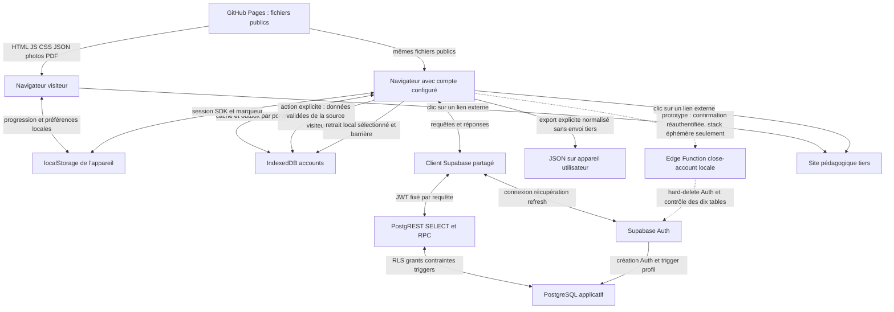

# Flux, prestataires et stockages terminaux

## Vérification ciblée D05/D06 — 5 novembre 2026

**P0-07 et P0-08 restent ouverts sur les conditions de la cible et de la remise privée.** Les trois services, les données par flux et les documents publics applicables en principe sont identifiés. Aucune console fournisseur, boîte personnelle, clause privée ou réponse hébergée contenant des données n’a été consultée. Les qualifications de rôle ci-dessous distinguent la documentation du fournisseur et l’appréciation du projet.

| Service et données du projet | Rôles par flux et conditions publiées | Localisation et garanties documentées | Copies, journaux et durée | Limite à consigner |
| --- | --- | --- | --- | --- |
| **GitHub Pages**. Fichiers pédagogiques publics et requêtes web, dont IP. La première requête du callback transporte la preuve temporaire dans sa query. Les résultats et profils restent en dehors de l’artefact. | GitHub distribue les fichiers choisis par l’exploitant. GitHub déclare collecter l’IP de tout visiteur Pages pour la sécurité et se présente comme responsable pour les opérations propres couvertes par sa déclaration. L’appliquer aux journaux de sécurité est une inférence motivée par la finalité déclarée. Conditions et déclaration générales effectives le 27/04/2026. L’accord de protection des données visé pour les produits fournis par une organisation n’est pas présumé applicable à ces visites. [Pages et IP](https://docs.github.com/en/pages/getting-started-with-github-pages/what-is-github-pages#data-collection), [conditions](https://docs.github.com/en/site-policy/github-terms/github-terms-of-service), [déclaration](https://docs.github.com/en/site-policy/privacy-policies/github-general-privacy-statement). | GitHub décrit des traitements aux États-Unis et dans d’autres pays, ainsi que des clauses types et le cadre UE–États-Unis (DPF) pour les transferts couverts. Ni résidence Pages exclusivement européenne ni mécanisme unique pour tous ses flux. [Transferts GitHub](https://docs.github.com/en/site-policy/privacy-policies/github-general-privacy-statement#international-data-transfers). | IP journalisée, critères généraux de conservation, caches et historique possibles des fichiers publics. Le stockage de la query du callback et le délai des logs Pages ne sont pas établis. | Le délai exhaustif des logs constitue une limite documentable. Le traitement de la query sensible reste à évaluer avant remise réelle des liens. |
| **Supabase Free**. Auth, PostgREST, PostgreSQL, e-mail/UUID/profil, progression et préférences, journaux techniques associés. | DPA v1 du 01/08/2026, intégré aux conditions standard : client responsable et Supabase Pte. Ltd sous-traitant pour les données traitées sur instructions, notamment données applicatives et support lié à celles-ci. Supabase décrit son rôle propre de responsable pour la gestion du compte client et sa facturation. Le plan gratuit n’écarte pas le DPA standard. Le rattachement de ces conditions à l’organisation qui portera la cible reste à confirmer. [Conditions](https://supabase.com/terms), [DPA](https://supabase.com/legal/customer-resources/data-processing-addendum). | La région AWS choisie détermine la résidence primaire de PostgreSQL et d’Auth selon Supabase. DEV eu-west-1 (Irlande) est un constat historique, sans preuve sur la cible finale. La FAQ v1 du 06/10/2026 distingue support mondial, métadonnées techniques hors région et ingestion/stockage des logs dans l’UE. SCC documentées vers Singapour et États-Unis, avec mesures d’accès, chiffrement et journalisation. La liste du 12/10/2026 confirme AWS pour l’hébergement et la filiale américaine pour le support. Elle n’établit pas que tous les sous-traitants listés reçoivent des données Mon BPREA. [Régions](https://supabase.com/docs/guides/platform/regions), [FAQ résidence et transferts](https://supabase.com/legal/privacy-resources/data-residency-and-transfers-faq), [liste de sous-traitants](https://supabase.com/legal/subprocessor-list/October-12-2026.pdf). | Free annonce un jour pour les logs **API/base** de la grille et aucune sauvegarde automatique Free ni PITR inclus. Ce jour ne couvre pas tous les logs Auth, le support ou les copies techniques. Le §11.2 du DPA prévoit la restitution sur demande dans les 30 jours suivant la fin du contrat et la suppression des copies couvertes à l’issue de cette période, sous les réserves contractuelles/légales. Le délai ne s’applique pas à chaque clôture de compte participant. [Grille](https://supabase.com/pricing), [FAQ sauvegardes Free, 30/10/2026](https://supabase.com/kb/faqs/platform/free-plan-backups), [DPA](https://supabase.com/legal/customer-resources/data-processing-addendum). | Confirmer sur la cible retenue : titulaire/organisation, plan/conditions/DPA, région principale et services effectivement utilisés. Documenter les mécanismes réellement pertinents et la procédure de retour/effacement. |
| **Microsoft Outlook.com / Hotmail personnel**. Adresse et contenu des échanges de contact, assistance/droits, et future remise individuelle des liens. | L’exploitant décide du contenu, du destinataire et du retrait de ses copies. Microsoft fournit le service grand public et décrit ses traitements propres, dont sécurisation et obligations légales. Qualification prudente de responsable distinct pour ces finalités propres. Une sous-traitance sur instructions pour la remise ou un DPA d’entreprise ne sont pas établis par la documentation grand public. Le contrat publié le 30/07/2026, effectif le 30/09/2026, désigne Microsoft Ireland Operations Limited selon sa clause territoriale pour l’EEE. La déclaration consultée est celle de septembre 2026. [Contrat](https://www.microsoft.com/fr-fr/servicesagreement), [confidentialité](https://www.microsoft.com/fr-fr/privacy/privacystatement), [comptes personnels et professionnels](https://support.microsoft.com/fr-fr/accounts-billing/manage/what-s-the-difference-between-a-microsoft-account-and-a-work-or-school-account). | Microsoft décrit les traitements dans la région, aux États-Unis et dans d’autres pays, avec SCC et DPF selon le périmètre. La boîte du destinataire constitue un flux distinct. [Confidentialité Microsoft](https://www.microsoft.com/fr-fr/privacy/privacystatement). | Reçus, envoyés, supprimés/récupérables, antispam, appareils et journaux. La déclaration indique environ 7 jours dans Éléments supprimés et jusqu’à 30 jours après vidage, sous réserve légale. L’aide Outlook.com indique 30 jours dans Éléments supprimés puis 30 jours de récupération. Aucun de ces délais ne prouve le délai global de cette boîte. [Aide Outlook.com](https://support.microsoft.com/fr-fr/outlook/mail/recover-and-restore-deleted-items-in-outlook). | La divergence et la localisation exacte de la boîte sont des limites à signaler. Pour les liens d’accès, confirmer que le cadre grand public et les garanties couvrent le flux réel retenu, ou qualifier un canal de remise différent. |

**Attestation exploitant.** La maîtrise opérationnelle de la boîte et le fonctionnement du contact reposent sur les attestations D04. Elles ne donnent ni le contrat applicable au compte ni les pays réellement mobilisés. [Reçu du 5 novembre](RECU-ARBITRAGES-2026-11-05.md).

### Suite proportionnée

- **Déterminant pour P0-07.** Lier les conditions publiques à l’organisation Supabase et au service effectivement retenu. Décrire en une fiche privée le circuit de remise, ses opérateurs et les données transmises. La récupération publique actuelle est assistée et ne demande pas d’adresse. Le projet prévoit une génération native de lien par un service de confiance et une remise privée, sans SMTP automatique ; les anciens modèles locaux ne prouvent pas un relais en service. Le SMTP Supabase par défaut est limité aux adresses d’équipe selon sa documentation et ne constitue pas une solution pour ces participants. Confirmer l’absence de maillon d’envoi automatique dans le circuit cible. Si la couverture de la remise par le contrat grand public est insuffisante, poser une question ciblée au fournisseur ou valider un autre canal avant de l’annoncer. [Guide du projet](../deploiement/INVITATIONS-ET-RECUPERATION-MANUELLES.md), [SMTP Supabase, 31/10/2026](https://supabase.com/docs/guides/auth/auth-smtp).
- **Déterminant pour P0-08.** Une fois la cible choisie, relever la région effective et rattacher la chaîne d’accès/support au DPA, aux SCC et aux garanties utiles pour les flux hors EEE. Vérifier le mécanisme effectivement invoqué et son périmètre si un flux dépend du DPF. Garder la preuve privée et permettre l’accès aux garanties pertinentes depuis le contact indiqué dans la notice. La zone d’un projet ne couvre pas l’ensemble des traitements techniques.
- **Limites documentables.** La liste exhaustive des datacenters d’un webmail personnel, les délais précis de toutes ses copies antispam et de tous les logs Pages ne sont pas des prérequis en eux-mêmes si les flux, rôles, garanties applicables, critères de conservation et limites sont exacts. La divergence Outlook n’est pas transposée en promesse. La query initiale d’un lien est un enjeu distinct de sécurité. Confirmer le comportement attendu du circuit réel et minimiser l’exposition avant les invitations.
- **Contrôle ciblé futur.** Après choix de cible et mandat, relever uniquement le titulaire, l’offre, les documents applicables, la région, les services actifs, la rétention accessible et la chaîne de remise. Aucune lecture de comptes participants, de messages ou de résultats requise pour cette fiche. Les informations d’exploitation restent privées.

Les sources ci-dessus ont été consultées le 05/11/2026. Le changelog public Supabase a été relu pour les sujets de cette vérification. Le lot documente les services et conserve le SDK et les migrations verrouillés. [Changelog](https://supabase.com/changelog).

## Cartographie technique historique et précisions d’usage

Les relevés du 27 et du 28 octobre 2026 ci-dessous conservent les capacités du dépôt au moment de l’inventaire. Pour les contrats et l’état des décisions, appliquer la vérification D ci-dessus. Le flux F08 décrit la chaîne préparée à l’époque : pour la future exploitation privée, la remise manuelle sans SMTP automatique est le choix en vigueur. Pour les accès au terminal, appliquer l’[analyse D12](ANALYSE-STOCKAGES-NAVIGATEUR-D12.md).

## Cartographie des chemins implémentés (A)

Le sous-graphe personnel décrit **un environnement configuré**. Le défaut public `enabled:false` s'arrête avant la création du client Supabase. Le diagramme ne prétend pas que des étudiants utilisent déjà ces flux. Les flèches locales ne sont pas des transferts réseau.

La flèche d'import ne concerne que cours/QCM, botanique, ITK et apparence ; elle suit un aperçu et une confirmation, conserve les sources, et ne résulte jamais de la simple connexion. Le Drill ne propose pas cet import. Un second appareil personnel suit le même chemin SDK/API/DB ; **aucun transfert direct entre appareils ni synchronisation du localStorage visiteur par Mon BPREA**. Une synchronisation propre au navigateur/OS n'est pas vérifiable depuis le dépôt.

## Fiches des flux

| Flux / statut | Source → destination, données et finalité | Quand / authentification / transport | Contrôle d'accès, persistance et risque |
| --- | --- | --- | --- |
| F01 — A | Navigateur → GitHub Pages → navigateur : fichiers statiques publics et requêtes HTTP | Visite/rechargement/chargement JSON et PDF ; pas de compte exigé. La chaîne de déploiement est [deploy.yml](../../.github/workflows/deploy.yml) → [prepare-pages.py](../../scripts/prepare-pages.py). HTTPS du site publié non retesté dans ce lot ; essais locaux HTTP boucle locale | Aucune donnée privée dans les fichiers publiés. Cache HTTP possible. **B** : IP journalisée par Pages pour la sécurité [B7]. Query initiale peut contenir A06/X03 ; logs fournisseur non accessibles. |
| F02 — A | Visiteur ↔ localStorage : D01/Q01/B01/I01/P01/P02/X01 ; progression et confort | Actions pédagogiques/choix, lectures au démarrage ; pas d'authentification ; flux interne sans TLS à qualifier | Même origine/profil, sans chiffrement applicatif ; données conservées, risque d'appareil partagé et de mauvaise attribution. Preuves : stores et services de l'inventaire. |
| F03 — A | Navigateur personnel ↔ IndexedDB : D02–D03/Q02–Q03/B02–B03/P05 | Avant envoi puis après confirmation/récupération ; session vérifiée ou continuité locale fiable limitée, transactions atomiques | Portée environnement/origine projet/UUID ; générations et annulation des retours tardifs. Reste lisible par le profil navigateur, conservé après déconnexion ; perte possible par quota/éviction. |
| F04 — A | Formulaire/SDK ↔ Supabase Auth : e-mail, mot de passe, preuve de lien, session et métadonnées retournées | Connexion, récupération, activation volontaire, refresh, déconnexion locale. `validateAuthConfiguration` exige HTTPS hors boucle locale DEV ; pas de mesure de TLS réel ni d'audit du réseau interne fournisseur | SDK gère A02/A03 ; service valide `getUser`. Marqueur A04 ne suffit pas pour une API distante. Mot de passe et tokens restent hors caches pédagogiques ; XSS/extensions et sessions persistantes restent des risques. |
| F05 — A | Navigateur/transport ↔ PostgREST SELECT : profil, séries et historiques personnels, paramètres | Démarrage, actualisation, retour réseau/Auth et relectures selon service, dont export explicite. Clé publique et JWT personnel ; HTTPS exigé en hébergé | Filtres `user_id`/`id` + RLS ; pages et passes complètes, pas de snapshot global. Réponses validées/cache P ; lecture partielle distincte d'un historique complet. [Transports](../../assets/settings-transport.js), [Drill](../../assets/drill-sync-transport.js), [cours](../../assets/course-quiz-transport.js), [botanique](../../assets/botanical-sync-transport.js), [export](../../assets/export-transport.js). |
| F06 — A | Outbox personnelle → SDK → PostgREST/RPC → PostgreSQL : intentions validées, UUID d'opération, base de révision, dates | Après persistance locale, retry exact et retour de session vérifiée ; pas d'envoi en mode seulement hors ligne | RPC Drill et six RPC personnelles `SECURITY INVOKER`, grants/RLS/guards aussi sur écritures directes ; CAS pour mutables, append-only pour historiques. Erreurs/pertes d'acquittement laissent copies et conflits. La clôture locale distincte relève de F16, pas de ces RPC. |
| F07 — A | Service de confiance → Auth → trigger profil | Invitation administrative native, **capacité préparée**, aucun appel d'invitation depuis le frontend ni dans cet audit | Création du profil atomique avec Auth ; trigger definer privé à droits retirés. Identité/habilitations du futur opérateur : D01/D02 des [décisions](DECISIONS-A-VALIDER.md). Pas de rôle formateur ou accès interétudiants implémenté par les migrations. |
| F08 — A/B/D | Auth → service d'e-mail → boîte du destinataire → lien Pages → `verifyOtp` Auth : adresse, message, preuve temporaire | Modèles [invite](../../supabase/templates/invite.html)/[recovery](../../supabase/templates/recovery.html) et reset implémentés ; expédition réelle, fournisseur SMTP, accès et chiffrement des maillons **non vérifiés** [B11] | Première query sensible reçue par l'hébergeur avant nettoyage. Confirmation explicite, `no-referrer`, pas de suivi de clic dans le code des modèles ; réglages réels du fournisseur inconnus. En CI, SMTP capturé uniquement dans la stack locale. |
| F09 — A | Source visiteur → mémoire d'aperçu → manifeste brut en P → RPC des seuls champs validés | Confirmation explicite, source/provenance inchangées et récupération distante fraîche ; même identité jusqu'au commit | Pas d'import implicite ; refus conservateurs des copies ambiguës, archives locales sans rétention temporelle. Risque : données visiteur appartenant à autrui et duplication dans `raw`. [Import cours](../../assets/course-quiz-import.js), [botanique](../../assets/botanical-import.js), [paramètres](../../assets/settings-service.js). |
| F10 — A | Onglet ↔ autres onglets de même origine : portée pédagogique X02, ou session Auth A07 | Après commit local / événement SDK ; BroadcastChannel, pas de TLS ni serveur car communication locale | Pas de stockage autonome. Le canal SDK peut porter une session complète, à ne jamais journaliser ; tous les scripts de même origine doivent être dignes de confiance. |
| F11 — A/D | Navigateur → site externe choisi : requête web, IP et métadonnées réseau du visiteur | Uniquement clic sur ressources/crédits/anecdote ; liens `noopener noreferrer` dans les composants concernés ; URL généralement HTTPS, pas d'audit du site cible | Aucun résultat personnel envoyé explicitement dans ces liens. Le site tiers applique ses propres traceurs/règles ; inconnus sans audit distinct. Les photos du jeu utilisent des chemins locaux, les PDF contrôlés automatiquement sont locaux. |
| F12 — A | Générateur ITK → DOM/Blob/impression → fichier utilisateur éventuel | Génération et clic CSV/impression, sans envoi de document complet à Supabase | Pas de stockage applicatif de calendriers/PDF/CSV complets. Une copie téléchargée, imprimée ou sauvegardée par l'OS échappe à une future suppression distante. |
| F13 — B/D | Infrastructure Pages/Auth/API/DB/SMTP → logs, sauvegardes et personnels habilités du prestataire | Capacités/prestations décrites officiellement [B7–B12] ; contenu et déclencheurs précis non observés dans le projet | Ce n'est pas un flux réseau démontré par le frontend pour chaque catégorie. Identifier contrats, sous-traitants, lieux, accès support et rétention ; RLS ne protège pas contre un administrateur privilégié. |

## Flux de droits ajoutés après l'inventaire initial

F05 est désormais aussi utilisé par l'export préparé ; F06 ne décrit que les écritures pédagogiques. Il n'y a pas d'endpoint d'export dédié : les SELECT existants sont utilisés. La clôture relève de F16.

| Flux / statut | Source → destination et données | Quand / autorisation | Persistance / limite |
| --- | --- | --- | --- |
| F14 — A, copie 6.4.2 | Auth/SELECT dix tables + quatre caches de la portée → mémoire → Blob/JSON remis au navigateur ; sélection visiteur indépendante | Action explicite, vérification Auth fraîche et JWT fixé ; deux passes concordantes, pas de snapshot global | Ni envoi tiers ni nouvelle écriture pédagogique. Secrets, bruts et champs non attribuables exclus ; téléchargement remis non rappelable. [Contrat](../architecture/EXPORT-DONNEES-PERSONNELLES.md). |
| F15 — A, retrait local 6.4.3 | Choix confirmé → transaction `accounts + privacy`, ou retrait des clés visiteur choisies | Identité personnelle fraîche, générations et Web Locks ; aucune requête de suppression serveur | Invalidation inter-onglets, barrières v2 par portée ; localStorage multiclés et quatre bases non globalement atomiques. États partiels explicites, B préservé. |
| F16 — A, clôture locale 6.4.3 | Navigateur → `close-account` → réauthentification Auth → hard-delete administratif → contrôle Auth/dix tables | Seulement API interne locale autorisée, JWT gateway + `getUser`, mot de passe courant puis capacité liée au JWT exact | Aucun UUID cible libre, secret admin côté serveur uniquement. Aucun déploiement. Pas de dossier de demande persistant ni log applicatif du contenu ; logs d'infrastructure non audités. [Protocole](../architecture/SUPPRESSION-DONNEES-PERSONNELLES.md). |

Il n'existe pas de connexion directe PostgreSQL depuis le navigateur. L'e-mail n'est pas répliqué dans les tables pédagogiques. Realtime, Storage et analytics ne sont pas utilisés. Une Edge Function de clôture **locale seulement** existe désormais ; elle refuse les origines Supabase hébergées. Sa présence ne prouve aucune activité DEV/PROD.

**Recette 6.4.4 :** les 17 documents de l'artefact local versionné sont examinés dans des contextes vierges, avec Auth désactivée ; aucun domaine externe sollicité, cookie/Set-Cookie, stockage personnel, Cache API ou service worker observé. Les liens tiers sont inventoriés sans navigation. Les parcours synthétiques de compte restent une preuve distincte de caches et session, pas celle de l'artefact public. La query de callback atteint bien la première requête HTTP avant nettoyage ; `q` peut rester dans l'URL. Périmètre et résultats : [validation](../validations/VALIDATION-LOT6-4-4.md). Aucune réponse réelle Pages/Supabase/SMTP hébergée n'est auditée ; aucune exemption juridique générale déduite.

## Prestataires et intervenants

| Intervenant | Rôle technique et données constatées/possibles | Localisation/transferts et qualification | À obtenir avant ouverture (D) |
| --- | --- | --- | --- |
| GitHub Pages / infrastructure GitHub | A : distribue les fichiers publics ; aucune progression n'est envoyée à GitHub par une API pédagogique. B : journalise l'IP des visites [B7] ; sa politique décrit ses propres traitements [B8] | Aucun engagement « UE exclusivement » vérifié. Qualification à analyser **par traitement** : hébergement du site, sécurité propre au prestataire et compte d'exploitation ne se confondent pas | Entité contractante/conditions applicables, rôle juridique selon activité, destinataires infrastructure, localisation/accès support, garanties de transfert, rétention des logs et traitement des queries sensibles. |
| Supabase Auth / API / PostgreSQL hébergé | A : client et schéma préparés pour comptes/profils/progression/préférences. B : régions, sessions, sauvegardes et DPA disponibles [B9–B12] | La base PostgreSQL applicative et le service Auth sont distincts logiquement dans l'inventaire, sans prétendre deux prestataires séparés. Région **du projet inconnue**. DPA public version du 01/08/2026 : rôles et garanties conditionnels au contrat ; une région principale ne couvre pas tous les accès/transferts | Souscription/plan, région effective de chaque projet, entité/contrat et rôle par activité, sous-traitants réellement mobilisés, lieux d'accès, mécanismes de transfert et garanties applicables, habilitations admin, backups/logs/PITR et effacement. |
| Sous-traitants de Supabase / hébergeur matériel PostgreSQL | B : index officiel de sous-traitants, liste annoncée au 12/10/2026 [B13]. Aucune déduction depuis le suffixe d'URL du projet | Liste détaillée non récupérée par le lecteur web pendant cet audit ; **ne pas attribuer arbitrairement AWS, une région ou un flux à une société** | Archiver en espace interne la liste applicable/contrat, identifier la chaîne d'hébergement et les catégories reçues, pays, accès et notifications de changement. |
| E-mails transactionnels et messagerie du destinataire | A : contenu des modèles/URL ; B : guide SMTP [B11]. Fournisseur SMTP réel non identifié | SMTP par défaut, personnalisé ou relais : choix/configuration non vérifiés ; réception par une messagerie externe implique une chaîne supplémentaire | Fournisseur/contrat, région/transferts, chiffrement et rétention, logs, antispam/réécriture, absence de suivi/pixel, SPF/DKIM/DMARC et responsabilité de l'invitant. Aucune invitation envoyée dans ce lot. |
| Sites de ressources/crédits | A : catalogue [resources.json](../../assets/resources.json), anecdotes [daily-facts.json](../../assets/daily-facts.json), crédits [botanical-bank.json](../../assets/botanical-bank.json) : Chlorofil, GRAB, CTIFL, EcophytoPIC, Météo-France/data.gouv, INRAE/ephytia, FAO, NC State, Kew, Wikimedia/Commons, Creative Commons et crédit Lucnix | Liens sortants, pas sous-traitants présumés ni intégrations recevant les résultats. Pas de chargement distant des photos à l'affichage du jeu. Localisation et traceurs de ces sites non audités | Réexaminer toute évolution vers contenu embarqué, iframe, CDN ou tracking avant activation. Information claire sur la sortie vers un site tiers. |
| Navigateurs, OS, extensions et appareil partagé | A : stockage et affichage local. Aucune synchronisation navigateur/OS implémentée par Mon BPREA | Pas de prestataire choisi par l'application pour ces copies ; réglages de l'utilisateur inconnus | Définir conseil d'usage, gestion des copies hors ligne et portée réaliste des droits sur les appareils absents. |
| npm/outils/CI | A : outils de développement Node 24, SDK compilé localement, fixtures synthétiques ; Chromium/CLI dans la stack de test | Pas de CDN de production ni transfert étudiant déduit de l'installation npm ; logs/traces CI pourraient devenir sensibles avec de mauvaises fixtures | Préserver données fictives, secrets masqués et artefacts non publiés ; documenter tout nouveau service d'observabilité avant usage. |

## Cookies et autres accès au terminal

**B :** la règle CNIL ne se limite pas aux cookies HTTP. L'exemption concerne une nécessité pour la communication ou un service expressément demandé ; les traitements personnels associés restent à examiner au titre du RGPD. [Règles CNIL, B2](https://www.cnil.fr/fr/cookies-et-autres-traceurs/regles/cookies/comment-mettre-mon-site-web-en-conformite), consultation 27/10/2026.

| Usage audité A | Qualification provisoire C / décision D | Conséquence proposée |
| --- | --- | --- |
| Session Auth persistée, marqueur de continuité, file/cache de synchronisation | Candidat à l'exemption fonctionnelle pour le service personnel demandé ; vérifier nécessité de chaque copie et durée, particulièrement mode hors ligne | Pas d'acceptation globale « RGPD ». Information sur persistance et ordinateur partagé ; justifier la conservation locale séparément de l'accès distant. |
| Sauvegarde visiteur des exercices/cours/botanique/ITK et provenances | Fonction de sauvegarde/reprise, pas marketing détecté ; absence de marketing ne suffit pas à démontrer l'exemption de chaque accès | D : préciser demande utilisateur, nécessité, durée et alternatives pour traces annexes/imports ; minimiser les sources brutes conservées dans les lots suivants. |
| Apparence et anecdote masquée | Personnalisation fonctionnelle, candidate à l'exemption selon le service attendu ; aucune audience ni publicité identifiée | Documenter choix, clés et durée réelle, sans présenter toutes préférences comme exemptées d'office. |
| Sites tiers sur clic | Traceurs du site cible inconnus ; aucune iframe/mesure d'audience intégrée détectée | Auditer avant ajout d'embarquement. Si une finalité non exemptée apparaît : consentement préalable adapté à cette finalité, à concevoir à ce moment. |
| Cookies infrastructure et cache HTTP | Dépôt seul insuffisant ; recette locale ne reproduit pas les réponses Pages/CDN/SMTP | Vérification ciblée de l'artefact et des réponses hébergées à prévoir dans la recette autorisée 6.4.4, sans donnée réelle. |

**C : aucun bandeau ajouté dans 6.4.1**, faute de finalité non exemptée détectée justifiant son implémentation. Ceci n'est ni une conclusion juridique d'exemption générale, ni une affirmation d'absence universelle de cookies/traceurs. Résultats navigateur limités dans le [rapport](../validations/VALIDATION-LOT6-4-1.md).

## Sources officielles (B), consultées le 27 octobre 2026

| Réf. | Source et portée vérifiée |
| --- | --- |
| B1 | [CNIL — registre des activités](https://www.cnil.fr/fr/RGPD-le-registre-des-activites-de-traitement) : finalités, contenu et nature interne du registre. |
| B2 | [CNIL — cookies et autres traceurs](https://www.cnil.fr/fr/cookies-et-autres-traceurs/regles/cookies/comment-mettre-mon-site-web-en-conformite) : nécessité, exemption et consentement selon finalité. |
| B3 | [CNIL — AIPD](https://www.cnil.fr/fr/ce-quil-faut-savoir-sur-lanalyse-dimpact-relative-la-protection-des-donnees-aipd) : listes et critères ; page canonique en timeout, contenu officiel accessible avec [variante de query](https://www.cnil.fr/fr/ce-quil-faut-savoir-sur-lanalyse-dimpact-relative-la-protection-des-donnees-aipd?trk=article-ssr-frontend-pulse_little-text-block). |
| B4 | [CNIL — information/transparence](https://www.cnil.fr/fr/conformite-rgpd-information-des-personnes-et-transparence) : clarté, moment et mentions d'information. |
| B5 | [RGPD — EUR-Lex](https://eur-lex.europa.eu/legal-content/FR/TXT/?uri=CELEX:32016R0679) : référence officielle demandée, lecture bloquée par vérification antirobot ; texte consulté sur CNIL, [chapitre II](https://www.cnil.fr/fr/reglement-europeen-protection-donnees/chapitre2), [chapitre III](https://www.cnil.fr/fr/reglement-europeen-protection-donnees/chapitre3), [chapitre IV](https://www.cnil.fr/fr/reglement-europeen-protection-donnees/chapitre4). |
| B6 | [Supabase — changelog](https://supabase.com/changelog) : consulté après échec de lecture du format `.md`. Avis TLS HTTP API du 12/10/2026 repéré ; aucune mise à jour SDK ou configuration introduite par ce lot documentaire. |
| B7 | [GitHub — fonctionnement Pages, Data collection](https://docs.github.com/en/pages/getting-started-with-github-pages/what-is-github-pages#data-collection) : collecte des IP de visites pour sécurité, même sans connexion GitHub. |
| B8 | [GitHub — politique générale de confidentialité](https://docs.github.com/en/site-policy/privacy-policies/github-general-privacy-statement) : traitements et transferts décrits par GitHub ; pas preuve du contrat de l'exploitant. |
| B9 | [Supabase — régions disponibles](https://supabase.com/docs/guides/platform/regions) : choix de régions, aucune identification du projet audité. |
| B10 | [Supabase — sessions](https://supabase.com/docs/guides/auth/sessions) : JWT/refresh et durée configurable ; ne pas assimiler expiration JWT et effacement des copies. |
| B11 | [Supabase — SMTP](https://supabase.com/docs/guides/auth/auth-smtp) : nécessité de vérifier la livraison et le fournisseur réel ; pas preuve de configuration hébergée. |
| B12 | [Supabase — sauvegardes](https://supabase.com/docs/guides/platform/backups) et [DPA](https://supabase.com/legal/customer-resources/data-processing-addendum) : capacités liées au plan et cadre contractuel public ; contrat/plan réel non vérifié. |
| B13 | [Supabase — index des sous-traitants](https://supabase.com/legal/customer-resources/subprocessor-list) : index daté ; contenu détaillé du document lié non récupéré, chaîne effective à confirmer. |

Ces sources ne remplacent pas les preuves contractuelles privées ni les décisions du responsable à identifier. Conserver ces dernières hors du dépôt public ; ne publier ici qu'un statut et les mentions autorisées nécessaires à l'information.
