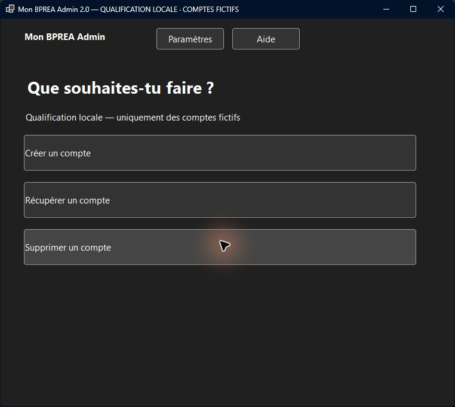
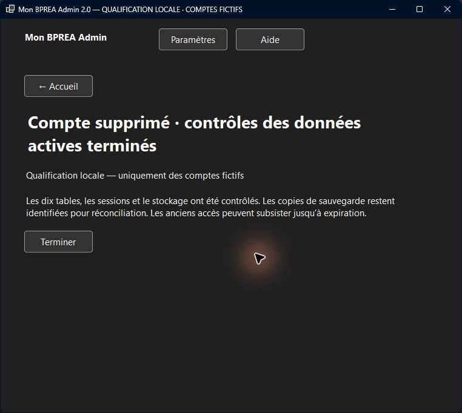

# Validation — Mon BPREA Admin V2

Date : **17 novembre 2026**. Branche `codex/mon-bprea-admin-v2`, issue de
`origin/main` `7115b722352ba5e951a1ae29bdc4e69f07938c02` (fusion #66).
Le [guide utilisateur](../../tools/mon-bprea-admin/README.md) décrit les gestes
courants ; l’[architecture et les limites](../../tools/mon-bprea-admin/DEVELOPPEMENT.md)
portent les contrats techniques et le plan de capacité PROD.

**Qualification locale du binaire final réussie**, après les deux correctifs P1
décrits ci-dessous. Les résultats sont liés aux artefacts identifiés dans ce
rapport ; ils ne sont pas attribués automatiquement à une future tête de PR.
Aucun succès de CI finale n’est revendiqué ici.

## Périmètre et artefact effectivement recetté

La V2 remplace les écrans techniques V1.2 par trois actions : créer, récupérer et
supprimer un compte. Première configuration intégrée, clé masquée mémorisée
automatiquement dans le Gestionnaire d’identifiants Windows, réouverture sans
ressaisie, liens et résultats sensibles DPAPI. Les cases d’attestation et les
phrases à recopier ont été retirées sans fabriquer de preuve de consentement.
Les réservations, verrous, journaux et protections contre les répétitions sont
conservés.

Deux campagnes ont utilisé Windows et le véritable exécutable autonome x64
produit par `publish.ps1`, version **2.0.0.0**, **non signé** :

| Campagne | SHA-256 de `MonBPREAAdmin.exe` | Portée |
| --- | --- | --- |
| Première recette conservée | `6033292ee9120821a00c55ad88007b1cd5bf03618fa1b785cddc4df084081646` | Parcours initiaux, avant les deux correctifs P1 |
| **Qualification finale** | `0c98645ddfa42c5fe0ca763291a7717a4470cb829860ccd9105eafe60e9cf1e1` | **116 361 050 octets**, distribution `reviewed-delivery`, création/activation, récupération combinée, suppression et réouverture |

Le ZIP à trois fichiers et son empreinte ont été contrôlés, puis l’application a
été lancée normalement. Le mode de qualification de ce même binaire fixe les
origines sur `127.0.0.1:54321`, `127.0.0.1:4173` et `127.0.0.1:54329`, avec coffre
et stockage distincts du service réel et bandeau permanent de qualification.
Les processus et données d’une campagne conservée n’ont pas été réinitialisés
pour rejouer une opération incertaine.

**Aucun compte réel, lien réel, secret PROD, réglage hébergé, grant, migration ou
politique RLS PROD n’a été modifié. Aucune publication GitHub Pages ni fusion
n’est incluse dans cette validation.**

## Contrôles automatisés de la version finale

| Contrôle réellement exécuté | Résultat acquis | Portée |
| --- | --- | --- |
| Vecteurs de contrat Node | 87 cas synthétiques | Parité des contrats administratifs historiques |
| Tests C#/stockage Windows | **2 524 assertions réussies** | Contrats, coffre et DPAPI réels dans des namespaces de test, verrous, persistance et refus ; transports Auth simulés pour les cas unitaires |
| Tests WinForms | **33 contrôles réussis** | Vraie boucle de messages, interface synthétique sans réseau : trois actions, clé masquée, copie volontaire, sélection, double clic, fermeture en cours d’opération et absence de cases |
| Tests Node ciblés des contrats/journaux, première campagne | **51 tests réussis** | Journaux V1/V1.1/V2 et refus des états ambigus ; preuve conservée de la première campagne |
| `npm test` complet | **640 réussis, 1 ignoré** | Non-régression unités/intégration du dépôt, après correctifs P1 |
| Compilation, inspection et smoke test | Réussis pour l’artefact identifié ci-dessus | x64 autonome, version, motifs sensibles connus, lancement/fermeture isolés et cohérence du ZIP |

Les tests unitaires des transports ne constituent pas une preuve RLS. Les
résultats initiaux (2 506 assertions C#, 27 contrôles WinForms et 637 tests Node
réussis) restent historiques ; les résultats finaux ci-dessus les complètent
après correction. Le test ignoré n’est pas compté comme réussi.

## Recette des parcours réels

La première stack **`mon-bprea-admin-v2-local`** et ses preuves restent conservées
sous `.tmp/mon-bprea-admin-v2/`. La qualification finale utilise une seconde
stack **`mon-bprea-admin-v2-final-local`** et le dossier distinct
`.tmp/mon-bprea-admin-v2/final-qualification/`, sans suppression de la première.
Les deux campagnes utilisent seulement la boucle locale, des identités fictives
et des navigateurs participants jetables. Les clés, mots de passe, liens et
contenus synthétiques complets restent hors du rapport.

| Parcours observé | Campagne | Résultat prouvé |
| --- | --- | --- |
| Première configuration | Finale | Un champ de clé masqué, contrôle de la cible locale, enregistrement automatique Windows et initialisation du stockage ; aucun chemin, JSON ou terminal demandé par l’application |
| Fermeture complète puis réouverture | Finale | Accueil directement sur trois actions, clé retrouvée sans nouvelle saisie |
| Création/activation | Finale | Adresse fictive, génération, copie volontaire dans l’application, ouverture dans un navigateur participant, choix du mot de passe puis connexion au vrai site local ; profil présent et rôle `authenticated` |
| Mot de passe seul | Première | Lien copié et utilisé dans un navigateur participant réel ; connexion avec le nouveau mot de passe, UUID/profil et dix tables conservés |
| Adresse seule | Première | Nouvelle adresse confirmée administrativement après décision sur le canal connu ; connexion avec l’ancien mot de passe, même UUID/profil et dix tables conservés |
| Adresse et mot de passe | Finale | Modification et relecture de la nouvelle adresse, puis lien destiné à cette adresse ; choix du nouveau mot de passe et connexion dans un navigateur neuf, même UUID et dix tables inchangées |
| Exploitant fictif protégé | Première | Tentative depuis l’interface refusée ; aucune suppression de cet exploitant |
| Suppression d’A | Finale | Une confirmation claire, réservation durable, suppression Auth native, postcontrôles des dix tables, sessions/refresh et témoin B, puis restauration réconciliée ; succès affiché par l’interface réelle |

Les fichiers `browser-password.json` et `browser-email.json` attestent les deux
parcours séparés de la première campagne ; leur format ne lie pas lui-même le
résultat à une empreinte de binaire. Ils ne sont pas réattribués au binaire final.
Les fichiers finaux `browser-activate.json`, `browser-combined.json` et les
preuves de suppression attestent les trois grandes fonctions sur le binaire
final identifié.

La confirmation d’adresse retenue utilise l’API administrative officielle du
même UUID. Elle n’est pas une confirmation OTP de l’ancienne boîte et ne prouve
pas automatiquement une identité ou la maîtrise d’une nouvelle boîte : la
vérification humaine proportionnée par un canal déjà connu reste indispensable.
Ce choix ne modifie pas le réglage de changement sécurisé du parcours étudiant
et ne fabrique aucune attestation juridique de consentement. Une génération de
récupération n’est pas annoncée comme un mot de passe déjà modifié.

La validité **1 800 secondes** affichée pendant la recette provient de la
configuration réellement lue du conteneur Auth local. Elle ne constitue pas une
durée PROD. En PROD, `/auth/v1/settings` ne publie pas cette information et
l’application annonce explicitement une durée inconnue.

## Suppression : preuves de données et de restauration

Les métadonnées finales ont été lues dans
`final-qualification/local-proof/metadata-before.json` et `metadata-after.json`.
Pour A, **chacune** des dix tables applicatives contenait une ligne avant la
suppression et zéro après. La première campagne avait obtenu ces mêmes comptages
avec ses propres fixtures et son propre témoin, conservés séparément :

| Table | Avant | Après |
| --- | ---: | ---: |
| `profiles` | 1 | 0 |
| `drill_series` | 1 | 0 |
| `drill_answers` | 1 | 0 |
| `drill_training_attempts` | 1 | 0 |
| `course_states` | 1 | 0 |
| `quiz_attempts` | 1 | 0 |
| `botanical_sessions` | 1 | 0 |
| `botanical_answers` | 1 | 0 |
| `itk_settings` | 1 | 0 |
| `appearance_preferences` | 1 | 0 |

- **Auth absent** après l’opération native ; sessions **5 → 0**, jetons de
  rafraîchissement **6 → 0**, orphelins **0 → 0**.
- Les **onze signatures FK** exactes sont présentes, validées et en cascade ;
  les protections RLS et privilèges applicatifs contrôlés restent conformes.
- Le digest des données du témoin B est identique avant et après. La relecture
  avec son propre accès étudiant conserve ses données ; le rôle administratif
  n’est pas utilisé pour prétendre prouver l’isolation étudiante.
- Le collecteur a produit un vrai `pg_dump` applicatif puis l’a restauré dans
  une base isolée avec structure Auth minimale. Données synthétiques, métadonnées
  et privilèges ont été comparés avant d’autoriser la suppression.
- L’ancienne preuve liée au journal antérieur est refusée après l’intention de
  suppression. La restauration est ensuite réconciliée avec le journal courant :
  A y est retiré et B préservé.
- Le dump brut reste conservé et identifié par l’intention de suppression.
  **La réconciliation démontrée ne signifie pas que cette copie brute a été
  effacée**, ni que toutes les copies sur appareils ou exports ont disparu.

Ces constats correspondent aux indicateurs de
`backup-and-restore.json` et `deletion-and-reconciliation.json` : comparaison
réussie, Auth et dix tables absents, B préservé, ancienne preuve rejetée, journal
courant réconcilié, copie brute conservée avec son marqueur. Aucune réponse
positive Auth seule n’est utilisée comme preuve d’effacement exhaustif.

Storage était désactivé dans la stack. Les métadonnées constatent zéro objet de
la cible avant et après ; **aucun scénario réel avec objet Storage non vide
n’a été exécuté**. La disparition de sessions/refresh n’est pas extrapolée à
l’invalidation immédiate de tous les JWT d’accès déjà émis : leur validité peut
subsister jusqu’à expiration.

## Sécurité, non-régression et revue finale

La cible normale reste le projet PROD fixe ; le mode de qualification ne peut
recevoir aucune URL distante. Les clés mémorisées ne sont pas affichées et les
liens ne sont ni ouverts ni copiés automatiquement. Le stockage DPAPI est lié au
compte Windows et au projet/namespace ; les journaux minimaux conservent les
identifiants et empreintes nécessaires sans adresse ou lien en clair. Une
réservation incertaine, un verrou interrompu, des événements orphelins ou un
historique introuvable ne doivent pas être effacés pour relancer l’opération.

La revue a identifié deux correctifs **P1 corrigés et vérifiés dans les suites
finales**, avant recompilation et seconde recette :

1. Rendre visible un échec de préparation du stockage au démarrage, au lieu de
   laisser l’utilisateur sans explication utilisable.
2. Bloquer une intention de clôture V4 orpheline dans le ledger ; la perte d’un
   événement associé ne doit pas autoriser silencieusement une nouvelle mutation.

La recompilation et la seconde recette locale sont terminées avec succès sur
l’artefact final identifié. Les cas d’échec ciblés restent des tests automatisés :
ils ne constituent pas une injection de toute la matrice d’erreurs dans le
dernier exécutable graphique.

**P0 avant toute activation de suppression PROD : capacité privilégiée absente.**
La distribution maintient le blocage avant tout DELETE PROD. La clé Auth seule
ne prouve pas les dépendances PostgreSQL, l’identité immuable de l’exploitant,
Storage ou la liaison sauvegarde/restauration/journal. Le plan précis du
[guide développeur](../../tools/mon-bprea-admin/DEVELOPPEMENT.md#architecture-prod-proposée-non-activée)
nécessite un provisionnement, une qualification et une autorisation propres ;
aucun privilège, rôle ou service PROD n’a été créé dans cette livraison.

Limites **P1** à conserver explicitement : durée des liens PROD inconnue,
exécutable non signé, reprise accompagnée d’un ancien historique non indexé,
copies résiduelles et restauration complète du profil Windows non qualifiées.
Ces limites ne sont pas masquées par une case déclarative.

## Captures réelles sélectionnées

Captures d’application Windows compilée et de navigateur participant isolé.
Les adresses visibles sont fictives. Les vues contenant une clé ou un lien
personnel utilisable n’ont pas été retenues.

### Qualification finale

| État | Capture |
| --- | --- |
| Première ouverture, clé masquée | [Configuration](illustrations/admin-v2/final-qualification/01-configuration.png) |
| Trois actions principales | [Accueil](illustrations/admin-v2/final-qualification/02-accueil.png) |
| Suppression et postcontrôles terminés | [Succès vérifié](illustrations/admin-v2/final-qualification/03-suppression-verifiee.jpg) |
| Réouverture sans saisie de clé | [Coffre Windows retrouvé](illustrations/admin-v2/final-qualification/04-reouverture.jpg) |
| Connexion du compte nouvellement activé | [Participant activé](illustrations/admin-v2/final-qualification/participant-activate.png) |
| Même UUID après changement d’adresse et de mot de passe | [Parcours combiné](illustrations/admin-v2/final-qualification/participant-combined.png) |

### Première campagne conservée

| État | Capture |
| --- | --- |
| Première ouverture, champ masqué | [Première configuration](illustrations/admin-v2/08-final-premiere-ouverture-sombre.png) |
| Trois choix principaux | [Accueil](illustrations/admin-v2/09-final-accueil-sombre.png) |
| Une adresse, un bouton | [Créer un compte](illustrations/admin-v2/10-final-creer-sombre.png) |
| Trois opérations de récupération | [Récupération](illustrations/admin-v2/11-final-recuperations-sombre.png) |
| Décision sur le titulaire et sa nouvelle adresse | [Confirmation d’adresse](illustrations/admin-v2/12-final-confirmation-adresse.png) |
| Compte exploitant refusé | [Protection de l’exploitant](illustrations/admin-v2/13-final-exploitant-protege.png) |
| Une seule confirmation de suppression | [Confirmation de suppression](illustrations/admin-v2/14-final-confirmation-suppression.png) |
| Participant activé dans le vrai navigateur local | [Activation](illustrations/admin-v2/participant-invite-final.png) |
| Mot de passe modifié après changement d’adresse | [Parcours combiné](illustrations/admin-v2/participant-combined.png) |

## Contrôles non exécutés et clôture de campagne

Ne sont pas revendiqués : redémarrage physique de Windows, restauration complète
d’un profil Windows perdu, lecteur d’écran, audit complet d’accessibilité,
appareils physiques supplémentaires, scénario Storage non vide, ni exécution de
toute la matrice d’échecs dans l’interface du dernier binaire. Les refus couverts
par les tests unitaires et les transports simulés ne deviennent pas des échecs
réels injectés dans le binaire graphique. Aucun parcours n’a été exécuté sur
PROD ou un navigateur personnel.

Le collecteur final a été arrêté, puis la stack finale arrêtée avec conservation
de ses données et volumes (`stop-preserved.private.log`). Les preuves des deux
campagnes sont conservées. `npm run delivery:complete` reste **à consigner après
son exécution** ; la tête finale et les conclusions CI sont **à vérifier dans la
PR**. Les sauvegardes historiques, dont celle du 29 octobre, sont hors périmètre
de nettoyage. Une CI sur une stack éphémère ne
renouvelle aucune preuve hébergée DEV ou PROD.
